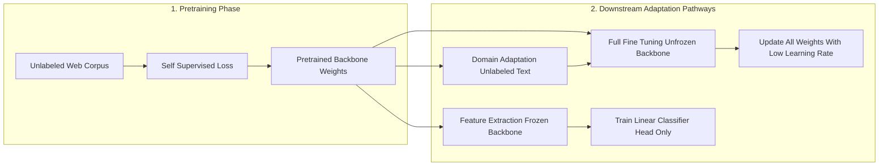
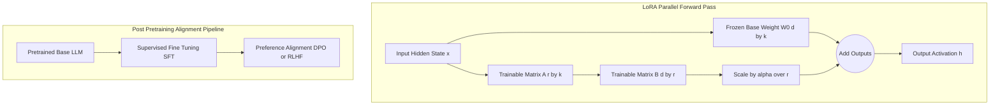
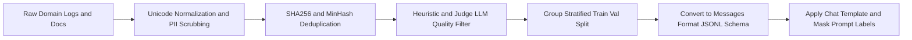

# Technical Research Manual Prepared By Aamna Ansari

## 8.1 Transfer Learning

### 1. Definition

**Transfer Learning (TL)** is a **Machine Learning (ML)** method where a model trained on a source domain and task is reused as the starting point for a different, related target domain or task ([Pan & Yang, 2010](https://www.cse.ust.hk/~qyang/Docs/2009/tkde_transfer_learning.pdf)). In **Natural Language Processing (NLP)**, transfer learning separates general language understanding from task-specific execution. Instead of initializing neural network weights randomly and training from scratch, practitioners load weights pretrained on large, unlabeled text corpora and adapt them to specialized downstream tasks ([Howard & Ruder, 2018](https://arxiv.org/abs/1801.06146); [Raffel et al., 2020](https://arxiv.org/abs/1910.10683)).

### 2. Why It Matters

Training deep **Artificial Neural Networks (ANNs)** from random initialization requires massive labeled datasets and high compute budgets. In most enterprise and research projects, labeled domain data—such as annotated medical records or legal contracts—is scarce and costly to create. Transfer learning solves this bottleneck by transferring core linguistic features (syntax, semantics, and world facts) learned from web-scale corpora to smaller target tasks. This cuts training time, lowers **Graphics Processing Unit (GPU)** compute needs, and reduces overfitting when labeled samples are limited ([Howard & Ruder, 2018](https://arxiv.org/abs/1801.06146)).

### 3. How It Works

Following [Pan & Yang (2010)](https://www.cse.ust.hk/~qyang/Docs/2009/tkde_transfer_learning.pdf), a domain $\mathcal{D} = \mathcal{X}, P(X)$ has a feature space $\mathcal{X}$ and marginal probability distribution $P(X)$ over inputs $X$. A task $\mathcal{T} = \mathcal{Y}, f(\cdot)$ has a label space $\mathcal{Y}$ and predictive function $f(x) = P(y \mid x)$. Given a source domain $\mathcal{D}_S$ with task $\mathcal{T}_S$ and a target domain $\mathcal{D}_T$ with task $\mathcal{T}_T$, transfer learning uses representations from $\mathcal{D}_S$ and $\mathcal{T}_S$ to learn the target predictive function $f_T(\cdot)$ when $\mathcal{D}_S \neq \mathcal{D}_T$ or $\mathcal{T}_S \neq \mathcal{T}_T$.

In **Transformer** architectures ([Vaswani et al., 2017](https://arxiv.org/abs/1706.03762)), pretraining optimizes a self-supervised objective over unlabeled text. Encoder models like **Bidirectional Encoder Representations from Transformers (BERT)** use **Masked Language Modeling (MLM)** ([Devlin et al., 2019](https://arxiv.org/abs/1810.04805)), while decoder-only **Large Language Models (LLMs)** use **Causal Language Modeling (CLM)** to minimize negative log-likelihood over a token sequence $x = (x_1, \dots, x_T)$:

$$
\mathcal{L}_{\text{CLM}}(\theta) = -\sum_{t=1}^{T} \log P(x_t \mid x_{<t}; \theta)
$$

Why pretraining + transfer works: lower and middle Transformer layers learn universal language features (word morphology, grammar, and coreference), while upper layers focus on next-token prediction. Because these base features apply across language tasks, pretrained weights $\theta_S$ start in a favorable region of the loss landscape.

Downstream transfer uses three main approaches:

1. **Feature Extraction**: Pretrained backbone weights $\theta_S$ remain frozen ($\nabla_{\theta_S} \mathcal{L}_T = 0$). Hidden states $h = g(x; \theta_S)$ pass into a small, trainable task head $\phi$, optimizing $\min_{\phi} \mathcal{L}_T(f(g(x; \theta_S); \phi), y)$.
2. **Fine-Tuning**: Both the backbone $\theta_S$ and task head $\phi$ are unfrozen and updated via **Stochastic Gradient Descent (SGD)** or **Adaptive Moment Estimation with Decoupled Weight Decay (AdamW)** ([Loshchilov & Hutter, 2019](https://arxiv.org/abs/1711.05101)): $\theta \leftarrow \theta - \eta \nabla_{\theta} \mathcal{L}_T(\theta, \phi)$, using a small learning rate $\eta$ to preserve pretrained representations.
3. **Domain Adaptation (Continued Pretraining)**: When target text differs strongly from general web text ($P(X_T) \neq P(X_S)$, such as clinical notes or source code), the model runs **Domain-Adaptive Pretraining (DAPT)** on unlabeled domain text before supervised task fine-tuning ([Gururangan et al., 2020](https://arxiv.org/abs/2004.10964)).

| Approach | Backbone ($\theta_S$) | Task Head ($\phi$) | Data Needed | Compute Cost | Main Trade-off |
| :--- | :--- | :--- | :--- | :--- | :--- |
| **Feature Extraction** ([Devlin et al., 2019](https://arxiv.org/abs/1810.04805)) | Frozen | Trainable | Small labeled set | Low (forward pass only) | Lower accuracy if task requires shifting internal features |
| **Domain Adaptation / DAPT** ([Gururangan et al., 2020](https://arxiv.org/abs/2004.10964)) | Trainable | LM head | Large unlabeled domain corpus | High | Adapts domain vocabulary but does not teach task instructions |
| **Full Fine-Tuning** ([Howard & Ruder, 2018](https://arxiv.org/abs/1801.06146)) | Trainable | Trainable | Medium/large labeled set | High (all gradients stored) | Highest task accuracy, but risks catastrophic forgetting |

**Link to LLMs**: Modern LLMs scale transfer learning by unifying diverse NLP tasks into a single generative text-to-text framework ([Raffel et al., 2020](https://arxiv.org/abs/1910.10683)). Rather than attaching task-specific classification heads, LLM fine-tuning adapts the model to generate answers directly as natural language tokens.

### 4. Architecture / Process Diagram

*(See Appendix A.1 for the corresponding Mermaid diagram source code.)*

### 5. Advantages

- **Data Efficiency**: Reaches strong accuracy on target tasks using hundreds or thousands of labeled examples instead of millions ([Howard & Ruder, 2018](https://arxiv.org/abs/1801.06146)).
- **Compute Savings**: Shares the one-time cost of self-supervised pretraining across many downstream applications.
- **Fast Convergence**: Starts near useful feature representations and typically converges quickly.

### 6. Limitations

- **Catastrophic Forgetting**: Updating all weights on a narrow dataset can overwrite pretraining knowledge and degrade general capabilities ([Howard & Ruder, 2018](https://arxiv.org/abs/1801.06146)).
- **Negative Transfer**: When source and target domains are unrelated, transferred features can hurt target performance ([Pan & Yang, 2010](https://www.cse.ust.hk/~qyang/Docs/2009/tkde_transfer_learning.pdf)).
- **Inherited Biases**: Models carry over demographic biases and factual errors from the pretraining corpus.

### 7. Use Cases

- **Clinical Text Classification**: Running DAPT on hospital notes followed by supervised diagnostic coding ([Gururangan et al., 2020](https://arxiv.org/abs/2004.10964)).
- **Low-Resource Ticket Routing**: Freezing an encoder backbone and training a linear classifier on support emails.
- **Cross-Lingual Adaptation**: Transferring a multilingual backbone to a low-resource regional language.

### 8. Practical Example

This snippet uses [Hugging Face Transformers](https://huggingface.co/docs/transformers/en/index) to load a pretrained sequence classifier, freeze the base encoder weights for feature extraction, and train only the classification head.

```python
from transformers import AutoModelForSequenceClassification

model = AutoModelForSequenceClassification.from_pretrained("distilbert-base-uncased", num_labels=2)

# Freeze pretrained encoder weights (feature extraction)
for name, param in model.named_parameters():
    if "classifier" not in name and "pre_classifier" not in name:
        param.requires_grad = False

trainable = sum(p.numel() for p in model.parameters() if p.requires_grad)
total = sum(p.numel() for p in model.parameters())
print(f"Trainable parameters: {trainable:,} / {total:,} ({100 * trainable / total:.2f}%)")
```

### 9. Implementation Considerations

- **Differential Learning Rates**: Use a smaller learning rate ($1 \times 10^{-5}$ to $5 \times 10^{-5}$) for unfrozen pretrained layers than for newly initialized heads ($1 \times 10^{-4}$ to $1 \times 10^{-3}$) to avoid distorting pretrained features ([Howard & Ruder, 2018](https://arxiv.org/abs/1801.06146)).
- **Warmup Schedule**: Warm up the learning rate over the first 5% to 10% of steps so AdamW variance estimates stabilize before full weight updates occur.
- **Tokenizer Matching**: Always use the exact tokenizer paired with the pretrained checkpoint so token IDs align with rows in the embedding matrix.

### 10. Key Takeaways

- Transfer learning reuses self-supervised language representations from large source corpora to solve target tasks with limited labeled data.
- Feature extraction freezes the backbone to save compute, whereas fine-tuning updates backbone weights for higher task adaptation at the risk of catastrophic forgetting.
- Modern LLMs rely on pretraining for broad knowledge acquisition and downstream fine-tuning for task formatting and behavioral alignment.

## 8.2 LLM Fine-Tuning (Full Fine-Tuning, Instruction Tuning, PEFT)

### 1. Definition

**LLM Fine-Tuning** is the post-pretraining optimization of a language model to control its instruction-following behavior, output format, or domain reasoning. It includes **Full Fine-Tuning (FFT)**, which updates 100% of model weights; **Supervised Fine-Tuning (SFT)** (or **Instruction Tuning**), which trains on `(instruction, response)` pairs ([Ouyang et al., 2022](https://arxiv.org/abs/2203.02155)); **Parameter-Efficient Fine-Tuning (PEFT)**, which freezes base weights and updates a small set of added parameters ([Hu et al., 2021](https://arxiv.org/abs/2106.09685)); and preference alignment via **Reinforcement Learning from Human Feedback (RLHF)** or **Direct Preference Optimization (DPO)** ([Rafailov et al., 2023](https://arxiv.org/abs/2305.18290)).

### 2. Why It Matters

A pretrained base LLM only predicts likely document continuations; given a user question, it may generate more questions instead of a helpful answer. Instruction tuning aligns the model to act as an assistant ([Ouyang et al., 2022](https://arxiv.org/abs/2203.02155)). Furthermore, as models grow from 7 billion to 70+ billion parameters, full fine-tuning demands massive **Video Random Access Memory (VRAM)**. PEFT methods reduce memory overhead so a 7B or 8B model can be fine-tuned on a single workstation GPU ([Dettmers et al., 2023](https://arxiv.org/abs/2305.14314)).

### 3. How It Works

**Instruction Tuning (SFT) Objective**: Given prompt tokens $x = (x_1, \dots, x_m)$ and target response tokens $y = (y_1, \dots, y_n)$, SFT minimizes cross-entropy loss over the response tokens while masking prompt tokens from gradient updates:

$$
\mathcal{L}_{\text{SFT}}(\theta) = -\sum_{t=1}^{n} \log P(y_t \mid x, y_{<t}; \theta)
$$

**Full Fine-Tuning Memory Bottleneck (Approximate Calculation)**: Updating all $N$ parameters with mixed-precision AdamW ([Loshchilov & Hutter, 2019](https://arxiv.org/abs/1711.05101)) stores:

- Model weights in 16-bit **Brain Floating Point (BF16)** or **16-bit Floating Point (FP16)**: $2\text{ bytes}/param$
- Gradients in 16-bit precision: $2\text{ bytes}/param$
- Optimizer states in **32-bit Floating Point (FP32)** (master weights $4\text{ bytes}$, first moment $m_t$ $4\text{ bytes}$, second moment $v_t$ $4\text{ bytes}$): $12\text{ bytes}/param$

This totals **approximately 16 bytes per parameter** in static memory (excluding activations). For a $7 \times 10^9$ (7B) model:

$$
\text{Static VRAM}_{\text{FFT}} \approx 7 \times 10^9 \times 16\text{ bytes} = 112\text{ GB (approx. } 104.3\text{ GiB)}
$$

Adding forward activations pushes memory past an 80 GB GPU unless distributed sharding like **Zero Redundancy Optimizer (ZeRO)** is used ([Rajbhandari et al., 2020](https://arxiv.org/abs/1910.02054)).

**PEFT Overview**:

1. **Adapters** ([Houlsby et al., 2019](https://arxiv.org/abs/1902.00751)): Inserts small bottleneck layers $h \leftarrow h + f(h W_{\text{down}})W_{\text{up}}$ sequentially inside each Transformer block, which adds inference latency.
2. **Prefix and Prompt Tuning** ([Li & Liang, 2021](https://arxiv.org/abs/2101.00190); [Lester et al., 2021](https://arxiv.org/abs/2104.08691)): Prepends $k$ learnable continuous vectors ("soft prompts") to attention layers (Prefix Tuning) or the input embedding layer (Prompt Tuning). This uses up $k$ context tokens and has limited capacity for complex tasks.
3. **Low-Rank Adaptation (LoRA)** ([Hu et al., 2021](https://arxiv.org/abs/2106.09685)): Freezes pretrained weight $W_0 \in \mathbb{R}^{d \times k}$ and models the update $\Delta W$ via low-rank matrices $A \in \mathbb{R}^{r \times k}$ and $B \in \mathbb{R}^{d \times r}$ with rank $r \ll \min(d, k)$:

$$
W = W_0 + \Delta W = W_0 + \frac{\alpha}{r} B A
$$

Matrix $A$ is initialized with Gaussian noise and $B$ is initialized to zero, so $\Delta W = 0$ at the start of training. At deployment, $\frac{\alpha}{r}BA$ merges directly into $W_0$, adding **zero inference latency**.
4. **Quantized LoRA (QLoRA)** ([Dettmers et al., 2023](https://arxiv.org/abs/2305.14314)): Stores frozen base weights $W_0$ in 4-bit **NormalFloat (NF4)** format ($0.5\text{ bytes}/param$) with double quantization and paged optimizers, dequantizing to 16-bit during forward/backward matrix multiplications while updating only 16-bit LoRA parameters. Base weight memory for a 7B model drops to roughly $7 \times 10^9 \times 0.55\text{ bytes} \approx 3.85\text{ GB}$, fitting on a single 16 GB or 24 GB GPU, though training is typically slower due to dequantization overhead.

**Preference Alignment (RLHF and DPO)**: To align outputs with human safety and quality preferences, **RLHF** trains a reward model $r_\phi(x, y)$ on human comparisons $(y_w \succ y_l \mid x)$ and tunes the policy $\pi_\theta$ via **Proximal Policy Optimization (PPO)** ([Schulman et al., 2017](https://arxiv.org/abs/1707.06347)) with a **Kullback-Leibler (KL)** penalty from the reference policy $\pi_{\text{ref}}$ ([Ziegler et al., 2019](https://arxiv.org/abs/1909.08593); [Ouyang et al., 2022](https://arxiv.org/abs/2203.02155)). **DPO** ([Rafailov et al., 2023](https://arxiv.org/abs/2305.18290)) removes the separate reward model and reinforcement learning loop by optimizing policy probabilities directly on chosen ($y_w$) and rejected ($y_l$) responses:

$$
\mathcal{L}_{\text{DPO}}(\pi_\theta; \pi_{\text{ref}}) = -\mathbb{E}_{(x, y_w, y_l)}\left[\log \sigma \left(\beta \log \frac{\pi_\theta(y_w \mid x)}{\pi_{\text{ref}}(y_w \mid x)} - \beta \log \frac{\pi_\theta(y_l \mid x)}{\pi_{\text{ref}}(y_l \mid x)}\right)\right]
$$

| Method                                                                               | Trainable Params | Approx. 7B Static VRAM      | Inference Latency             | Main Trade-off                                                               |
| :----------------------------------------------------------------------------------- | :--------------- | :-------------------------- | :---------------------------- | :--------------------------------------------------------------------------- |
| **Full Fine-Tuning (FFT)**                                                           | 100%             | ~112 GB (BF16 + FP32 AdamW) | None                          | Maximum plasticity, but high VRAM cost and forgetting risk                   |
| **Series Adapters** ([Houlsby et al., 2019](https://arxiv.org/abs/1902.00751))       | ~0.5% – 3.0%     | ~16 GB – 20 GB              | Moderate (sequential layers)  | Small checkpoints, but slows token generation                                |
| **Prefix / Prompt Tuning** ([Lester et al., 2021](https://arxiv.org/abs/2104.08691)) | ~0.01% – 0.1%    | ~15 GB – 16 GB              | Low (consumes context window) | Tiny footprint, but lower accuracy on complex reasoning                      |
| **LoRA (16-bit)** ([Hu et al., 2021](https://arxiv.org/abs/2106.09685))              | ~0.1% – 2.0%     | ~16 GB – 18 GB              | Zero (merged into $W_0$)      | Often matches FFT on many SFT tasks; lower capacity on massive domain shifts |
| **QLoRA (4-bit NF4)** ([Dettmers et al., 2023](https://arxiv.org/abs/2305.14314))    | ~0.1% – 2.0%     | > Approx ~5 GB – 8 GB       | Zero (if dequantized/merged)  | Lowest VRAM, but typically slower training from dequantization               |

**When to Fine-Tune vs. When Not To**:

- **Use Retrieval-Augmented Generation (RAG)** ([Lewis et al., 2020](https://arxiv.org/abs/2005.11401)), **not fine-tuning**, when injecting frequently changing or verifiable factual documents, as fine-tuned weights compress facts lossily and hallucinate.
- **Use In-Context Learning (ICL)** / few-shot prompting when a general model already follows the task with a few examples.
- **Use Fine-Tuning (LoRA/QLoRA)** when enforcing strict output schemas (e.g., **JavaScript Object Notation (JSON)**), adopting domain-specific tone, or distilling capabilities into a smaller, cheaper model.

### 4. Architecture / Process Diagram

*(See Appendix A.2 for the corresponding Mermaid diagram source code.)*

### 5. Advantages

- **Low Hardware Barrier**: LoRA and QLoRA cut optimizer memory by over 95% by updating only low-rank adapters ([Hu et al., 2021](https://arxiv.org/abs/2106.09685); [Dettmers et al., 2023](https://arxiv.org/abs/2305.14314)).
- **Multi-Adapter Serving**: One frozen base model in VRAM can dynamically serve dozens of lightweight task adapters (20–100 MB each).
- **Shorter Inference Prompts**: Replaces long few-shot system prompts with learned behavior, reducing **Application Programming Interface (API)** latency.

### 6. Limitations

- **Hallucination Amplification**: Training on unfamiliar factual targets can teach the model to fabricate answers confidently.
- **Alignment Tax**: Over-optimizing SFT or DPO on narrow tasks can reduce general reasoning performance ([Ouyang et al., 2022](https://arxiv.org/abs/2203.02155)).
- **Dequantization Overhead**: QLoRA reduces memory but training is typically slower due to on-the-fly NF4-to-16-bit conversion.

### 7. Use Cases

- **Schema Enforcement**: Training a 7B model to emit valid JSON or **Structured Query Language (SQL)** queries from natural language.
- **Domain Assistant Customization**: Adapting open-weights models to legal contract review or medical triage workflows.
- **Safety Alignment**: Using DPO to reduce unsafe completions and enforce stylistic constraints ([Rafailov et al., 2023](https://arxiv.org/abs/2305.18290)).

### 8. Practical Example

This snippet uses [bitsandbytes](https://huggingface.co/docs/bitsandbytes/en/index), [Hugging Face PEFT](https://huggingface.co/docs/peft/en/index), and the **Transformer Reinforcement Learning (TRL)** library ([TRL SFTTrainer](https://huggingface.co/docs/trl/en/sft_trainer)) to configure 4-bit QLoRA across all attention and feed-forward linear layers on a Google Colab T4 GPU.

```python
import torch
from transformers import AutoModelForCausalLM, AutoTokenizer, BitsAndBytesConfig
from peft import LoraConfig
from trl import SFTTrainer, SFTConfig

bnb_config = BitsAndBytesConfig(
    load_in_4bit=True, bnb_4bit_quant_type="nf4",
    bnb_4bit_compute_dtype=torch.float16, bnb_4bit_use_double_quant=True,
)

model_id = "Qwen/Qwen2.5-1.5B"
tokenizer = AutoTokenizer.from_pretrained(model_id)
model = AutoModelForCausalLM.from_pretrained(model_id, quantization_config=bnb_config, device_map="auto")

peft_config = LoraConfig(
    r=16, lora_alpha=32, lora_dropout=0.05, bias="none",
    target_modules=["q_proj", "k_proj", "v_proj", "o_proj", "gate_proj", "up_proj", "down_proj"],
    task_type="CAUSAL_LM",
)
# trainer = SFTTrainer(model=model, train_dataset=train_ds, peft_config=peft_config,
#                      args=SFTConfig(output_dir="./qlora_out", per_device_train_batch_size=2, fp16=True))
```

### 9. Implementation Considerations

- **Apply LoRA to All Linear Layers**: Targeting both attention and **Multi-Layer Perceptron (MLP)** projections (`q_proj`, `k_proj`, `v_proj`, `o_proj`, `gate_proj`, `up_proj`, `down_proj`) matches full fine-tuning far better than attention-only adapters ([Dettmers et al., 2023](https://arxiv.org/abs/2305.14314)).
- **Alpha-to-Rank Scaling**: Set `lora_alpha` to $1 \times r$ or $2 \times r$ (e.g., $r=16, \alpha=32$) and use a higher learning rate ($1 \times 10^{-4}$ to $2 \times 10^{-4}$) than full fine-tuning ($1 \times 10^{-5}$).
- **Safe Adapter Merging**: Never merge LoRA weights directly into a 4-bit quantized base model; reload the base model in 16-bit on **Central Processing Unit (CPU)** or GPU memory first, call `merge_and_unload()`, and then re-quantize.

### 10. Key Takeaways

- Full fine-tuning requires roughly 16 bytes of static VRAM per parameter in mixed-precision AdamW, making PEFT essential for single-GPU setups.
- LoRA and QLoRA often match full fine-tuning quality on many instruction-tuning tasks by learning low-rank updates across all linear layers while keeping base weights frozen.
- Fine-tune to control structure, tone, and task logic, but pair the model with RAG whenever accurate, updatable facts are required.

## 8.3 Dataset Preparation for Fine-Tuning

### 1. Definition

**Dataset Preparation for Fine-Tuning** is the data engineering pipeline that converts raw text logs, documents, or human demonstrations into clean, deduplicated, chat-templated, and tokenized sequences for supervised or preference training. It covers data collection, cleaning, exact and fuzzy deduplication, quality filtering, schema formatting, tokenization, sequence length management, and leakage-free train/validation splitting.

### 2. Why It Matters

In LLM fine-tuning, **quality matters more than quantity**. The **Less Is More for Alignment (LIMA)** study showed that a small, carefully curated dataset of 1,000 demonstrations can give strong results when aligning a pretrained model ([Zhou et al., 2023](https://arxiv.org/abs/2305.11206)). Because a model acquires most of its knowledge during pretraining, fine-tuning primarily teaches output style and behavioral alignment. Training on noisy, duplicated, or poorly formatted records degrades reasoning, causes infinite generation loops, and invalidates evaluation metrics.

### 3. How It Works

A production dataset pipeline executes seven core stages (matching the seven stages in the architecture diagram):

1. **Raw Domain Logs and Document Collection**: Domain records, support logs, and human demonstrations are gathered from source repositories and internal databases.
2. **Unicode Normalization and PII Scrubbing**: Raw records from **Portable Document Format (PDF)** files, support tickets, or web scrapes often contain broken **Unicode Transformation Format - 8-bit (UTF-8)** text, **HyperText Markup Language (HTML)** tags, and **Personally Identifiable Information (PII)**. Text is normalized using **Unicode Normalization Form KC (NFKC)**, stripped of markup, and scrubbed of PII via regex and entity filters.
3. **Exact and Fuzzy Deduplication**: Duplicate prompts cause memorization and distort validation scores ([Lee et al., 2022](https://arxiv.org/abs/2107.06499)). Pipelines remove exact matches via **Secure Hash Algorithm 256-bit (SHA-256)** hashes, then remove near-duplicates using **MinHash** and **Locality-Sensitive Hashing (LSH)** to estimate **Jaccard Similarity** over word or character $n$-grams sets $A$ and $B$:

$$
J(A, B) = \frac{|A \cap B|}{|A \cup B|}
$$

Pairs above a similarity threshold (typically $J(A, B) \ge 0.85$) are deduplicated.
4. **Heuristic and Judge LLM Quality Filtering**: Heuristic rules drop truncated answers, refusal boilerplate, and extreme length outliers. Model-based filters use a strong judge LLM or reward model to score instruction clarity and response accuracy, keeping only top-tier demonstrations.
5. **Group-Stratified Train/Validation Split and Leakage Prevention**: When creating the train/validation/test split (e.g., 90%/5%/5%), records must be split **after** deduplication and grouped by source document or user session to prevent **data leakage** between training and evaluation sets.
6. **Schema Formatting and JSONL Serialization**: Datasets are serialized in **JSON Lines (JSONL)** format, storing one JSON object per line ([Ward, 2013](https://jsonlines.org/)). Three schemas are standard:

| Format | Schema Structure | Multi-Turn | System Role | Primary Use Case |
| :--- | :--- | :--- | :--- | :--- |
| **Alpaca** ([Taori et al., 2023](https://crfm.stanford.edu/2023/03/13/alpaca.html)) | `{"instruction": "...", "input": "...", "output": "..."}` | No | Prepend to instruction | Single-turn task instruction datasets |
| **ShareGPT** ([Chiang et al., 2023](https://www.lmsys.org/blog/2023-03-30-vicuna/)) | `{"conversations": [{"from": "human", "value": "..."}, {"from": "gpt", "value": "..."}]}` | Yes | Optional `"system"` turn | Community dialogue datasets and multi-turn scripts |
| **Messages format (used with chat templates)** ([Hugging Face Chat Templates](https://huggingface.co/docs/transformers/en/chat_templating)) | `{"messages": [{"role": "system", "content": "..."}, {"role": "user", "content": "..."}, {"role": "assistant", "content": "..."}]}` | Yes | Native `"role": "system"` | Standard input for Hugging Face `TRL` and `apply_chat_template` |

**Sample JSONL Record (Messages format)**:

```json
{"messages": [{"role": "system", "content": "You are a clinical pharmacology assistant. Output concise, evidence-based dosing notes."}, {"role": "user", "content": "Summarize renal dosing adjustments for Metformin."}, {"role": "assistant", "content": "Metformin is contraindicated in patients with an estimated glomerular filtration rate (eGFR) below 30 mL/min/1.73 m². Initiation is not recommended if eGFR is between 30 and 45 mL/min/1.73 m²."}]}
```

7. **Chat Templates, Tokenization, Loss Masking, and Max Sequence Length**: Subword tokenizers like **Byte-Pair Encoding (BPE)** ([Sennrich et al., 2016](https://arxiv.org/abs/1508.07909)) rely on model-specific control tokens (e.g., `<|im_start|>`, `<|im_end|>`, `<|eot_id|>`) to mark turn boundaries. Calling `tokenizer.apply_chat_template()` formats the `messages` list into the exact token sequence expected by the base checkpoint ([Hugging Face Chat Templates](https://huggingface.co/docs/transformers/en/chat_templating)). To train only on assistant answers, label IDs for system and user tokens are set to `-100` (ignored by **PyTorch** cross-entropy):

$$
\mathcal{L}_{\text{masked}}(\theta) = -\frac{1}{\sum_{t=1}^{T} \mathbb{I}(m_t = 1)} \sum_{t=1}^{T} \mathbb{I}(m_t = 1) \log P(x_t \mid x_{<t}; \theta)
$$

where $m_t \in 0, 1$ masks prompt tokens ($m_t = 0$) and keeps assistant tokens ($m_t = 1$). Standard attention memory scales as $O(L^2)$ with sequence length $L$, or $O(L)$ with **Input/Output (IO)**-aware **FlashAttention** ([Dao et al., 2022](https://arxiv.org/abs/2205.14135)). If `max_seq_length` is too small, responses get truncated before the **End-of-Sequence (EOS)** token, teaching the model not to stop generating. **Sequence packing** combines short examples into one context window to avoid wasting compute on **Padding (PAD)** tokens.

**Dataset Size Guidelines (Approximate Rule of Thumb)**:

- **Style, Format, or Schema Alignment**: 500 to 2,000 clean examples ([Zhou et al., 2023](https://arxiv.org/abs/2305.11206)).
- **Single Domain Task**: 2,000 to 15,000 examples (approximate rule of thumb).
- **Broad Multi-Task Instruction Tuning**: 10,000 to 100,000+ diverse examples ([Taori et al., 2023](https://crfm.stanford.edu/2023/03/13/alpaca.html)).

### 4. Architecture / Process Diagram

*(See Appendix A.3 for the corresponding Mermaid diagram source code.)*

### 5. Advantages

- **Higher Accuracy at Lower Cost**: A small, carefully curated dataset where noisy and duplicate rows are removed cuts GPU training time while improving generalization ([Zhou et al., 2023](https://arxiv.org/abs/2305.11206); [Lee et al., 2022](https://arxiv.org/abs/2107.06499)).
- **Clean Generation Stopping**: Filtering out over-length examples instead of truncating them preserves EOS tokens and prevents runaway outputs.
- **Reliable Evaluation**: Group-stratified splitting prevents train-test leakage from inflating validation metrics.

### 6. Limitations

- **Annotation Cost**: Curating 1,000 expert-verified domain examples requires substantial human review time.
- **Synthetic Bias Amplification**: Training heavily on unverified LLM-generated outputs can reinforce hallucinations and repetitive phrasing.
- **Tokenizer Sensitivity**: Mismatched chat templates between training and inference silently degrade model accuracy.

### 7. Use Cases

- **Support Automation**: Turning scrubbed helpdesk transcripts into multi-turn **Messages format (used with chat templates)** JSONL records.
- **Code Assistant Curation**: Filtering repository pull requests by unit test pass rates and length before SFT.
- **Medical Summarization**: Formatting clinical discharge summaries with strict document-level train/test isolation.

### 8. Practical Example

This script uses [Hugging Face Datasets](https://huggingface.co/docs/datasets/en/index) and [Transformers](https://huggingface.co/docs/transformers/en/chat_templating) to deduplicate records via SHA-256 hashing, filter short outputs, convert Alpaca rows into the **Messages format (used with chat templates)**, and apply a native chat template with version-safe token length filtering.

```python
import hashlib
from datasets import Dataset
from transformers import AutoTokenizer

raw_records = [
    {"instruction": "Explain LoRA rank r.", "input": "", "output": "Rank r defines the inner dimension of low-rank matrices A and B, controlling trainable capacity."},
    {"instruction": "Explain LoRA rank r.", "input": "", "output": "Rank r defines the inner dimension of low-rank matrices A and B, controlling trainable capacity."},
    {"instruction": "Write a note.", "input": "", "output": "OK"}  # Filtered out (too short)
]

tokenizer = AutoTokenizer.from_pretrained("Qwen/Qwen2.5-1.5B-Instruct")
seen_hashes, cleaned = set(), []

for row in raw_records:
    prompt_key = (row["instruction"].strip() + " " + row["input"].strip()).strip()
    h = hashlib.sha256(prompt_key.encode("utf-8")).hexdigest()
    if h not in seen_hashes and len(row["output"].split()) >= 5:
        seen_hashes.add(h)
        cleaned.append({
            "messages": [
                {"role": "system", "content": "You are a precise machine learning research assistant."},
                {"role": "user", "content": prompt_key},
                {"role": "assistant", "content": row["output"].strip()},
            ]
        })

def format_and_count(ex):
    formatted_text = tokenizer.apply_chat_template(ex["messages"], tokenize=False)
    return {
        "formatted_text": formatted_text,
        "num_tokens": len(tokenizer(formatted_text)["input_ids"]),
    }

ds = Dataset.from_list(cleaned)
ds = ds.map(format_and_count)
ds = ds.filter(lambda ex: ex["num_tokens"] <= 2048)
```

### 9. Implementation Considerations

- **Decode One Batch Before Training**: Always run `tokenizer.decode()` on a training batch's `input_ids` and unmasked `labels` to verify that special turn tokens and the final EOS token are intact.
- **Do Not Add Special Tokens Carelessly**: Calling `tokenizer.add_special_tokens()` resizes the embedding matrix; under LoRA, new token rows remain untrained unless `embed_tokens` and `lm_head` are explicitly added to `modules_to_save` ([Hugging Face Chat Templates](https://huggingface.co/docs/transformers/en/chat_templating)).
- **Distinct Pad and EOS Tokens**: Never set `pad_token = eos_token` if your data collator masks all `pad_token_id` tokens in the labels, as this masks the target EOS token and teaches the model never to stop generating.

### 10. Key Takeaways

- Quality matters more than quantity: a small, carefully curated dataset of clean, diverse, expert-verified examples can give strong results ([Zhou et al., 2023](https://arxiv.org/abs/2305.11206)).
- Store data in the model-agnostic **Messages format (used with chat templates)** in JSONL and apply `tokenizer.apply_chat_template()` dynamically rather than hardcoding control tokens.
- Deduplicate and group by source document before splitting into train and validation sets, and filter out over-length sequences to preserve EOS tokens.

## References for These Sections

1. **Chiang, W.-L., et al. (2023).** *Vicuna: An Open-Source Chatbot Impressing GPT-4 with 90% ChatGPT Quality.* LMSYS Org Blog. [https://www.lmsys.org/blog/2023-03-30-vicuna/](https://www.lmsys.org/blog/2023-03-30-vicuna/)
2. **Dao, T., Fu, D. Y., Ermon, S., Rudra, A., & Ré, C. (2022).** *FlashAttention: Fast and Memory-Efficient Exact Attention with IO-Awareness.* Advances in Neural Information Processing Systems (NeurIPS), arXiv:2205.14135. [https://arxiv.org/abs/2205.14135](https://arxiv.org/abs/2205.14135)
3. **Dettmers, T., Pagnoni, A., Holtzman, A., & Zettlemoyer, L. (2023).** *QLoRA: Efficient Finetuning of Quantized LLMs.* Advances in Neural Information Processing Systems (NeurIPS), arXiv:2305.14314. [https://arxiv.org/abs/2305.14314](https://arxiv.org/abs/2305.14314)
4. **Devlin, J., Chang, M.-W., Lee, K., & Toutanova, K. (2019).** *BERT: Pre-training of Deep Bidirectional Transformers for Language Understanding.* Proceedings of NAACL-HLT 2019, arXiv:1810.04805. [https://arxiv.org/abs/1810.04805](https://arxiv.org/abs/1810.04805)
5. **Gururangan, S., Marasović, A., Swayamdipta, S., Lo, K., Beltagy, I., Downey, D., & Smith, N. A. (2020).** *Don't Stop Pretraining: Adapt Language Models to Domains and Tasks.* Proceedings of ACL 2020, arXiv:2004.10964. [https://arxiv.org/abs/2004.10964](https://arxiv.org/abs/2004.10964)
6. **Houlsby, N., Giurgiu, A., Jastrzebski, S., Morrone, B., De Laroussilhe, Q., Gesmundo, A., Attariyan, M., & Gelly, S. (2019).** *Parameter-Efficient Transfer Learning for NLP.* Proceedings of ICML 2019, arXiv:1902.00751. [https://arxiv.org/abs/1902.00751](https://arxiv.org/abs/1902.00751)
7. **Howard, J., & Ruder, S. (2018).** *Universal Language Model Fine-tuning for Text Classification.* Proceedings of ACL 2018, arXiv:1801.06146. [https://arxiv.org/abs/1801.06146](https://arxiv.org/abs/1801.06146)
8. **Hu, E. J., Shen, Y., Wallis, P., Allen-Zhu, Z., Li, Y., Wang, S., Wang, L., & Chen, W. (2021).** *LoRA: Low-Rank Adaptation of Large Language Models.* International Conference on Learning Representations (ICLR 2022), arXiv:2106.09685. [https://arxiv.org/abs/2106.09685](https://arxiv.org/abs/2106.09685)
9. **Hugging Face (2024).** *Transformers, Chat Templates, PEFT, TRL, Datasets, and bitsandbytes Documentation.* [https://huggingface.co/docs/transformers/en/chat_templating](https://huggingface.co/docs/transformers/en/chat_templating) | [https://huggingface.co/docs/peft/en/index](https://huggingface.co/docs/peft/en/index) | [https://huggingface.co/docs/trl/en/sft_trainer](https://huggingface.co/docs/trl/en/sft_trainer) | [https://huggingface.co/docs/datasets/en/index](https://huggingface.co/docs/datasets/en/index) | [https://huggingface.co/docs/bitsandbytes/en/index](https://huggingface.co/docs/bitsandbytes/en/index)
10. **Lee, K., Ippolito, D., Nystrom, A., Zhang, C., Eck, D., Callison-Burch, C., & Carlini, N. (2022).** *Deduplicating Training Data Makes Language Models Better.* Proceedings of ACL 2022, arXiv:2107.06499. [https://arxiv.org/abs/2107.06499](https://arxiv.org/abs/2107.06499)
11. **Lester, B., Al-Rfou, R., & Constant, N. (2021).** *The Power of Scale for Parameter-Efficient Prompt Tuning.* Proceedings of EMNLP 2021, arXiv:2104.08691. [https://arxiv.org/abs/2104.08691](https://arxiv.org/abs/2104.08691)
12. **Lewis, P., Perez, E., Piktus, A., Petroni, F., Karpukhin, V., Goyal, N., Küttler, H., Lewis, M., Yih, W.-t., Rocktäschel, T., Riedel, S., & Kiela, D. (2020).** *Retrieval-Augmented Generation for Knowledge-Intensive NLP Tasks.* Advances in Neural Information Processing Systems (NeurIPS), arXiv:2005.11401. [https://arxiv.org/abs/2005.11401](https://arxiv.org/abs/2005.11401)
13. **Li, X. L., & Liang, P. (2021).** *Prefix-Tuning: Optimizing Continuous Prompts for Generation.* Proceedings of ACL 2021, arXiv:2101.00190. [https://arxiv.org/abs/2101.00190](https://arxiv.org/abs/2101.00190)
14. **Loshchilov, I., & Hutter, F. (2019).** *Decoupled Weight Decay Regularization.* International Conference on Learning Representations (ICLR 2019), arXiv:1711.05101. [https://arxiv.org/abs/1711.05101](https://arxiv.org/abs/1711.05101)
15. **Ouyang, L., Wu, J., Jiang, X., Almeida, D., Wainwright, C. L., Mishkin, P., Zhang, C., Agarwal, S., Slama, K., Ray, A., Schulman, J., Hilton, J., Kelton, F., Miller, L., Simens, M., Askell, A., Welinder, P., Christiano, P., Leike, J., & Lowe, R. (2022).** *Training Language Models to Follow Instructions with Human Feedback.* Advances in Neural Information Processing Systems (NeurIPS), arXiv:2203.02155. [https://arxiv.org/abs/2203.02155](https://arxiv.org/abs/2203.02155)
16. **Pan, S. J., & Yang, Q. (2010).** *A Survey on Transfer Learning.* IEEE Transactions on Knowledge and Data Engineering, 22(10), 1345–1359. [https://www.cse.ust.hk/~qyang/Docs/2009/tkde_transfer_learning.pdf](https://www.cse.ust.hk/~qyang/Docs/2009/tkde_transfer_learning.pdf)
17. **Rafailov, R., Sharma, A., Mitchell, E., Ermon, S., Manning, C. D., & Finn, C. (2023).** *Direct Preference Optimization: Your Language Model is Secretly a Reward Model.* Advances in Neural Information Processing Systems (NeurIPS), arXiv:2305.18290. [https://arxiv.org/abs/2305.18290](https://arxiv.org/abs/2305.18290)
18. **Raffel, C., Shazeer, N., Roberts, A., Lee, K., Narang, S., Matena, M., Zhou, Y., Li, W., & Liu, P. J. (2020).** *Exploring the Limits of Transfer Learning with a Unified Text-to-Text Transformer.* Journal of Machine Learning Research (JMLR), 21(140), 1–67, arXiv:1910.10683. [https://arxiv.org/abs/1910.10683](https://arxiv.org/abs/1910.10683)
19. **Rajbhandari, S., Rasley, J., Ruwase, O., & He, Y. (2020).** *ZeRO: Memory Optimizations Toward Training Trillion Parameter Models.* Proceedings of SC20, arXiv:1910.02054. [https://arxiv.org/abs/1910.02054](https://arxiv.org/abs/1910.02054)
20. **Schulman, J., Wolski, F., Dhariwal, P., Radford, A., & Klimov, O. (2017).** *Proximal Policy Optimization Algorithms.* arXiv:1707.06347. [https://arxiv.org/abs/1707.06347](https://arxiv.org/abs/1707.06347)
21. **Sennrich, R., Haddow, B., & Birch, A. (2016).** *Neural Machine Translation of Rare Words with Subword Units.* Proceedings of ACL 2016, arXiv:1508.07909. [https://arxiv.org/abs/1508.07909](https://arxiv.org/abs/1508.07909)
22. **Taori, R., Gulrajani, I., Zhang, T., Dubois, Y., Li, X., Guestrin, C., Liang, P., & Hashimoto, T. B. (2023).** *Stanford Alpaca: An Instruction-Following LLaMA Model.* Stanford Center for Research on Foundation Models (CRFM). [https://crfm.stanford.edu/2023/03/13/alpaca.html](https://crfm.stanford.edu/2023/03/13/alpaca.html)
23. **Vaswani, A., Shazeer, N., Parmar, N., Uszkoreit, J., Jones, L., Gomez, A. N., Kaiser, Ł., & Polosukhin, I. (2017).** *Attention Is All You Need.* Advances in Neural Information Processing Systems (NeurIPS), arXiv:1706.03762. [https://arxiv.org/abs/1706.03762](https://arxiv.org/abs/1706.03762)
24. **Ward, I. (2013).** *JSON Lines Specification.* [https://jsonlines.org/](https://jsonlines.org/)
25. **Zhou, C., Liu, P., Xu, P., Iyer, S., Sun, J., Mao, Y., Ma, X., Efrat, A., Yu, P., Yu, L., Zhang, S., Ghosh, G., Lewis, M., Zettlemoyer, L., & Levy, O. (2023).** *LIMA: Less Is More for Alignment.* Advances in Neural Information Processing Systems (NeurIPS), arXiv:2305.11206. [https://arxiv.org/abs/2305.11206](https://arxiv.org/abs/2305.11206)
26. **Ziegler, D. M., Stiennon, N., Wu, J., Brown, T. B., Radford, A., Amodei, D., Christiano, P., & Irving, G. (2019).** *Fine-Tuning Language Models from Human Preferences.* arXiv:1909.08593. [https://arxiv.org/abs/1909.08593](https://arxiv.org/abs/1909.08593)

## Appendix: Mermaid Diagram Source Code

### A.1 Section 8.1 — Transfer Learning Diagram



### A.2 Section 8.2 — LoRA and Post-Pretraining Alignment Diagram



### A.3 Section 8.3 — Dataset Preparation Pipeline Diagram


