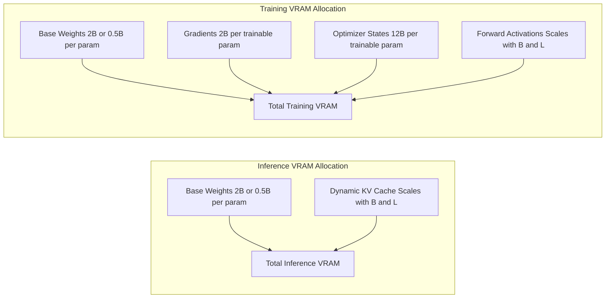
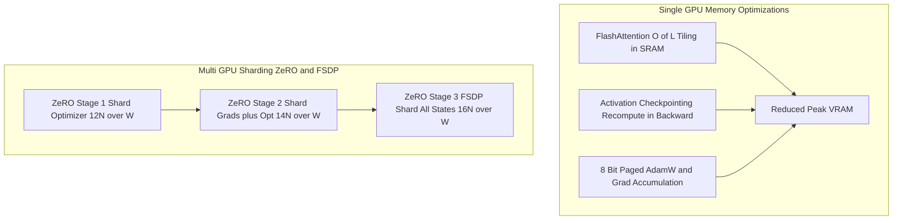
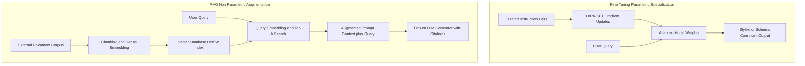
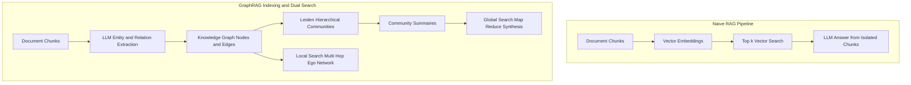

## Prepared By Aamna Ansari

## 8.7 GPU Requirements for Training and Inference

### 1. Definition
**Graphics Processing Unit (GPU) Requirements for Training and Inference** define the hardware compute, **Video Random Access Memory (VRAM)** capacity, memory bandwidth, and interconnect specifications needed to train, fine-tune, or serve a **Large Language Model (LLM)**. Inference requires storing frozen model weights and a dynamic **Key-Value (KV) Cache** for autoregressive token generation, whereas training additionally stores parameter gradients, high-precision optimizer states, and intermediate forward-pass activations ([Micikevicius et al., 2018](https://arxiv.org/abs/1710.03740); [Korthikanti et al., 2022](https://arxiv.org/abs/2205.05198)).

### 2. Why It Matters
Underestimating GPU requirements leads to immediate **Out-of-Memory (OOM)** crashes during training or severe latency bottlenecks in production serving. Conversely, over-provisioning enterprise GPUs wastes capital budget when **Parameter-Efficient Fine-Tuning (PEFT)** or quantization would fit on smaller hardware ([Dettmers et al., 2023](https://arxiv.org/abs/2305.14314)). Furthermore, LLM workloads split into two hardware regimes: training and prompt processing (**prefill**) are **compute-bound** (limited by **Floating-Point Operations Per Second (FLOPS)** on GPU **Tensor Cores**), while token-by-token generation (**decode**) is **memory-bandwidth-bound** (limited by how fast weights move from **High Bandwidth Memory (HBM)** to on-chip **Static Random Access Memory (SRAM)**) ([Dao et al., 2022](https://arxiv.org/abs/2205.14135); [Kwon et al., 2023](https://arxiv.org/abs/2309.06180)).

### 3. How It Works
Total GPU VRAM utilization is the sum of four primary components plus **Compute Unified Device Architecture (CUDA)** kernel context overhead ($M_{\text{CUDA}} \approx 1\text{ to }2\text{ GB}$):

$$\text{VRAM}_{\text{total}} = M_{\text{weights}} + M_{\text{gradients}} + M_{\text{optimizer}} + M_{\text{activations / KV}} + M_{\text{CUDA}}$$

1. **Inference Memory Breakdown (Approximate Calculation)**: During inference, $M_{\text{gradients}} = 0$ and $M_{\text{optimizer}} = 0$. A model with $N$ parameters stored in $b_{\text{w}}$ bytes per parameter requires $M_{\text{weights}} = N \times b_{\text{w}}$ ($2\text{ bytes}$ for **16-bit Brain Floating Point (BF16)** or **16-bit Floating Point (FP16)**; $1\text{ byte}$ for **8-bit Integer (INT8)**; $0.5\text{ bytes}$ for **4-bit Integer (INT4)** or **4-bit NormalFloat (NF4)**).
   To avoid recomputing attention keys and values for previous tokens, the model stores a **KV Cache**. For batch size $B$, sequence length $L$, Transformer layers $n_{\text{layers}}$, key/value heads $n_{\text{kv\_heads}}$ (using **Multi-Head Attention (MHA)** or **Grouped-Query Attention (GQA)** ([Ainslie et al., 2023](https://arxiv.org/abs/2305.13245))), head dimension $d_{\text{head}}$, and precision $b_{\text{kv}}$ bytes:

   $$M_{\text{KV}} = 2 \times B \times L \times n_{\text{layers}} \times n_{\text{kv\_heads}} \times d_{\text{head}} \times b_{\text{kv}}$$

   For an approximate 7B-class GQA model ($n_{\text{layers}}=32, n_{\text{kv\_heads}}=8, d_{\text{head}}=128$) in BF16 ($b_{\text{kv}}=2$) at $B=1, L=4096$:
   $M_{\text{KV}} \approx 2 \times 1 \times 4096 \times 32 \times 8 \times 128 \times 2\text{ bytes} \approx 536.87\text{ MB}$ ($\approx 0.54\text{ GB}$). Under older MHA ($n_{\text{kv\_heads}}=32$), the same cache consumes $\approx 2.15\text{ GB}$. Adding $M_{\text{weights}} \approx 7 \times 10^9 \times 2\text{ bytes} = 14\text{ GB}$ and $\approx 1.5\text{ GB}$ buffer yields **approximately 16 GB to 18 GB VRAM** for 7B BF16 inference, or **approximately 6 GB to 8 GB** in 4-bit precision.

2. **Training Memory Breakdown (Approximate Calculation)**:
   - **Full Fine-Tuning (FFT)** in mixed-precision **Adaptive Moment Estimation with Decoupled Weight Decay (AdamW)** ([Micikevicius et al., 2018](https://arxiv.org/abs/1710.03740); [Loshchilov & Hutter, 2019](https://arxiv.org/abs/1711.05101)) stores BF16 weights ($2N\text{ bytes}$), BF16 gradients ($2N\text{ bytes}$), and **32-bit Floating Point (FP32)** master weights, first moment $m_t$, and second moment $v_t$ ($4N + 4N + 4N = 12N\text{ bytes}$), totaling **approximately $16N$ bytes** of static memory ($\approx 112\text{ GB}$ for 7B, $\approx 208\text{ GB}$ for 13B, and $\approx 1,120\text{ GB}$ for 70B) before activations.
   - **Low-Rank Adaptation (LoRA)** ([Hu et al., 2021](https://arxiv.org/abs/2106.09685)) freezes $W_0$ ($2N\text{ bytes}$ in BF16) and allocates gradients and FP32 AdamW states ($14\text{ bytes/param}$) only for trainable adapter weights $P_{\text{LoRA}} \ll N$ (often under $1\%$, up to about $2\%$ of $N$). Static VRAM for a 7B model drops to $\approx 14\text{ GB} + (0.1\text{B} \times 14\text{ bytes}) \approx 15.4\text{ GB}$ plus activations.
   - **Quantized LoRA (QLoRA)** ([Dettmers et al., 2023](https://arxiv.org/abs/2305.14314)) compresses $W_0$ to 4-bit NF4 ($\approx 0.55N\text{ bytes}$ including quantization scales), cutting 7B static memory to $\approx 3.85\text{ GB} + 1.4\text{ GB} \approx 5.25\text{ GB}$ plus activations.

| Model Scale | 16-Bit Inference (BF16) | 4-Bit Inference (NF4/INT4) | Full Fine-Tuning (BF16 + AdamW) | LoRA SFT (16-Bit Base) | QLoRA SFT (4-Bit Base) | Typical Hardware Tier |
| :--- | :--- | :--- | :--- | :--- | :--- | :--- |
| **7B – 8B** | ~16 – 18 GB | ~6 – 8 GB | ~120 – 160 GB (Multi-GPU) | ~18 – 24 GB | ~8 – 14 GB | 1x RTX 4090 (24 GB) or 1x A100/H100 (80 GB) |
| **13B – 14B** | ~28 – 32 GB | ~10 – 13 GB | ~220 – 280 GB (Multi-GPU) | ~32 – 40 GB | ~14 – 20 GB | 1x RTX 4090 (QLoRA) or 1x A100 (80 GB) |
| **70B – 72B** | ~145 – 160 GB | ~40 – 48 GB | ~1.2 – 1.5 TB (Node Cluster) | ~155 – 180 GB | ~46 – 64 GB | 1x A100/H100 80 GB (QLoRA) or 2–8x 80 GB GPUs |

*Note: All VRAM values in the table above are approximate and include static states plus moderate batch ($B=1\text{ to }2, L=2048$) activation or KV cache overhead.*

| GPU Model | VRAM | BF16 Support | FlashAttention-2 Support | Typical Role |
| :--- | :--- | :--- | :--- | :--- |
| **NVIDIA T4** (Turing) | 16 GB | No (use FP16; verify on NVIDIA datasheet) | No (requires Ampere or newer; use SDPA) | Budget inference, small-model (1.5B–3B) or 7B 4-bit QLoRA prototyping |
| **NVIDIA RTX 4090** (Ada) | 24 GB | Yes (native) | Yes | Workstation inference, 7B–14B QLoRA and 7B 16-bit LoRA fine-tuning |
| **NVIDIA A100** (Ampere) | 40 GB / 80 GB | Yes (native) | Yes | Enterprise LoRA/QLoRA (up to 70B on 80 GB) and multi-GPU FSDP/ZeRO training |
| **NVIDIA H100** (Hopper) | 80 GB (verify SXM/NVL variants on NVIDIA datasheet) | Yes (native + FP8) | Yes (plus FlashAttention-3 support) | High-throughput production serving and large-scale multi-node full fine-tuning |

### 4. Architecture / Process Diagram


### 5. Advantages
- **Predictable Capacity Planning**: Analytical byte-counting equations prevent hardware under-sizing before provisioning cloud instances.
- **Cost-Optimal Hardware Selection**: Matching workload regimes (compute-bound prefill vs. bandwidth-bound decode) avoids paying for flagship data-center GPUs when workstation cards suffice.
- **Single-GPU Accessibility**: QLoRA formulas confirm when 7B to 14B models can fit inside a single 24 GB GPU ([Dettmers et al., 2023](https://arxiv.org/abs/2305.14314)).

### 6. Limitations
- **Dynamic Activation Spikes**: Analytical static formulas do not capture temporary PyTorch memory allocator fragmentation or intermediate logit tensor spikes ($B \times L \times V$, where vocabulary size $V > 128,000$).
- **Interconnect Bottlenecks**: Splitting a 70B model across multiple PCIe GPUs without high-speed **NVLink** introduces severe communication latency during tensor parallelism or gradient synchronization.
- **Quantization Accuracy Trade-offs**: Pushing inference to 4-bit reduces VRAM by nearly $4\times$ but can slightly degrade complex arithmetic or coding accuracy compared to BF16.

### 7. Use Cases
- **Cloud Cluster Budgeting**: Estimating the exact number of 80 GB H100 nodes required to full fine-tune a 70B domain foundation model.
- **Edge and Local Deployment**: Sizing 4-bit quantized 8B models for on-premise workstation GPUs with 16 GB or 24 GB VRAM.
- **High-Concurrency Serving**: Calculating maximum concurrent user sessions supported by remaining KV cache memory on a serving node ([Kwon et al., 2023](https://arxiv.org/abs/2309.06180)).

### 8. Practical Example
This script uses pure Python arithmetic to compute approximate static and KV-cache VRAM requirements across inference, FFT, LoRA (16-bit base), and QLoRA for any model configuration.

```python
def estimate_vram_gb(params_b=7.0, layers=32, kv_heads=8, head_dim=128, seq_len=4096, batch=1):
    n = params_b * 1e9
    kv_bytes = 2 * batch * seq_len * layers * kv_heads * head_dim * 2  # BF16 KV cache
    inf_bf16 = (n * 2 + kv_bytes) / 1e9 + 1.5  # +1.5 GB CUDA buffer
    fft_bf16 = (n * 16) / 1e9 + 4.0            # 16 B/param static + ~4 GB activations
    lora_16bit = (n * 2 + (0.015 * n) * 14) / 1e9 + 2.5     # 16-bit base + 1.5% LoRA params
    qlora_4bit = (n * 0.55 + (0.015 * n) * 14) / 1e9 + 2.5  # 4-bit base + 1.5% LoRA params
    return {
        "Inference_BF16_GB": round(inf_bf16, 1),
        "FFT_Static_GB": round(fft_bf16, 1),
        "LoRA_16bit_GB": round(lora_16bit, 1),
        "QLoRA_GB": round(qlora_4bit, 1),
    }

print("Approximate 7B VRAM Estimates (GB):", estimate_vram_gb(params_b=7.0))
```

### 9. Implementation Considerations
- **Account for Vocabulary Logit Tensors**: Modern LLMs use large vocabularies ($V \ge 128,256$). In FP32, a single cross-entropy logit tensor of shape $(B=2, L=4096, V=128256)$ consumes $2 \times 4096 \times 128256 \times 4\text{ bytes} \approx 4.2\text{ GB}$ of VRAM by itself.
- **Leave a 10%–15% VRAM Safety Margin**: Never size a workload to 100% of physical GPU capacity; PyTorch's caching allocator requires headroom to avoid expensive memory defragmentation stalls.
- **Verify BF16 Hardware Support**: Native BF16 requires NVIDIA Ampere (compute capability $\ge 8.0$, e.g., A100, RTX 3090/4090) or newer architectures; older Turing/Volta GPUs fall back to FP16, which has a narrower dynamic exponent range and risks gradient underflow/overflow ([Micikevicius et al., 2018](https://arxiv.org/abs/1710.03740)).

### 10. Key Takeaways
- Inference VRAM is dominated by model weights ($2\text{ bytes/param}$ in BF16 or $0.5\text{ bytes/param}$ in 4-bit) plus the dynamic KV cache, whereas full training requires roughly $16\text{ bytes/param}$ for weights, gradients, and FP32 AdamW states.
- Prefill and training are compute-bound (FLOPS-limited), whereas autoregressive token decoding is memory-bandwidth-bound (HBM-to-SRAM transfer-limited).
- GQA shrinks the KV cache by sharing key/value heads across query groups, and QLoRA shrinks training weights to 4-bit so 7B–14B models can be fine-tuned on a single 24 GB GPU.

## 8.8 GPU Memory Utilization and Optimization

### 1. Definition
**GPU Memory Utilization and Optimization** refers to algorithmic, kernel-level, and distributed systems techniques that reduce peak VRAM consumption and eliminate memory bandwidth bottlenecks during LLM training and inference. Core techniques include **Activation Checkpointing** (gradient checkpointing) ([Chen et al., 2016](https://arxiv.org/abs/1604.06174)), **Gradient Accumulation**, **Mixed-Precision Training** ([Micikevicius et al., 2018](https://arxiv.org/abs/1710.03740)), **8-Bit and Paged Optimizers** ([Dettmers et al., 2022](https://arxiv.org/abs/2110.02861)), **FlashAttention** ([Dao et al., 2022](https://arxiv.org/abs/2205.14135)), **Zero Redundancy Optimizer (ZeRO)** / **Fully Sharded Data Parallel (FSDP)** ([Rajbhandari et al., 2020](https://arxiv.org/abs/1910.02054); [Zhao et al., 2023](https://arxiv.org/abs/2304.11277)), and **PagedAttention** ([Kwon et al., 2023](https://arxiv.org/abs/2309.06180)).

### 2. Why It Matters
Even when static model weights and optimizer states fit in VRAM via LoRA or QLoRA, intermediate forward activations grow rapidly with batch size $B$ and sequence length $L$ ([Korthikanti et al., 2022](https://arxiv.org/abs/2205.05198)). Without memory optimization, training on long contexts ($L \ge 4096$) triggers OOM errors even on 80 GB GPUs. Furthermore, standard attention implementations repeatedly read and write massive $L \times L$ attention matrices to slow GPU HBM, leaving compute units idle. Memory optimization unlocks long-context training, higher batch throughput, and multi-GPU scaling without altering mathematical convergence.

### 3. How It Works
Memory optimization targets four distinct bottlenecks:

1. **Activation Checkpointing (Gradient Checkpointing)** ([Chen et al., 2016](https://arxiv.org/abs/1604.06174); [Korthikanti et al., 2022](https://arxiv.org/abs/2205.05198)): Standard backpropagation stores all intermediate layer activations during the forward pass to compute weight gradients in the backward pass, scaling memory as $O(n_{\text{layers}} \cdot B \cdot L \cdot d_{\text{model}})$. Activation checkpointing discards intermediate activations inside each Transformer block during the forward pass—saving only block boundary inputs—and recomputes them on the fly during backpropagation. This reduces activation memory from $O(n_{\text{layers}})$ to roughly $O(\sqrt{n_{\text{layers}}})$ at the cost of approximately 20% to 33% extra compute time (one additional forward pass per micro-batch).

2. **Gradient Accumulation**: Optimization stability often requires a large effective batch size $B_{\text{eff}}$ (e.g., 64 or 128 sequences), which cannot fit in VRAM simultaneously. Gradient accumulation splits $B_{\text{eff}}$ into $K$ sequential micro-batches of size $b_{\text{micro}}$:

   $$B_{\text{eff}} = b_{\text{micro}} \times K_{\text{accum}} \times W_{\text{GPUs}}, \quad g_{\text{total}} = \frac{1}{K_{\text{accum}}} \sum_{k=1}^{K_{\text{accum}}} \nabla_\theta \mathcal{L}_k(\theta)$$

   Activations are freed after each micro-batch backward pass, accumulating gradients in-place before calling `optimizer.step()` once every $K_{\text{accum}}$ steps.

3. **IO-Aware FlashAttention** ([Dao et al., 2022](https://arxiv.org/abs/2205.14135)): Standard scaled dot-product attention $\text{softmax}(QK^T / \sqrt{d_k})V$ materializes the full $L \times L$ attention matrix in GPU HBM, requiring $O(L^2)$ memory. FlashAttention tiles inputs $Q, K, V$ into fast on-chip SRAM blocks and uses online softmax rescaling to compute exact attention without ever writing the $L \times L$ matrix to HBM, reducing attention memory complexity to **$O(L)$** and accelerating wall-clock speed by $2\times$ to $4\times$.

4. **Optimizer Quantization and Distributed Sharding**:
   - **8-Bit and Paged Optimizers** ([Dettmers et al., 2022](https://arxiv.org/abs/2110.02861); [Dettmers et al., 2023](https://arxiv.org/abs/2305.14314)): Block-wise quantization compresses FP32 AdamW momentum states ($m_t, v_t$) from $8\text{ bytes/param}$ to $2\text{ bytes/param}$ (reducing static optimizer memory by 75%), while paged optimizers use CUDA unified memory to page optimizer states to **Central Processing Unit (CPU)** RAM during activation spikes.
   - **ZeRO and PyTorch FSDP** ([Rajbhandari et al., 2020](https://arxiv.org/abs/1910.02054); [Zhao et al., 2023](https://arxiv.org/abs/2304.11277)): Instead of replicating all $16N\text{ bytes}$ across $W$ data-parallel GPUs, **ZeRO Stage 1** shards optimizer states ($4N + \frac{12N}{W}$), **ZeRO Stage 2** shards optimizer states and gradients ($2N + \frac{14N}{W}$), and **ZeRO Stage 3 / FSDP** shards weights, gradients, and optimizer states ($\frac{16N}{W}$), gathering parameters on demand via `all-gather` collectives.
   - **PagedAttention for Inference** ([Kwon et al., 2023](https://arxiv.org/abs/2309.06180)): Partitions the inference KV cache into fixed-size non-contiguous virtual memory blocks (pages), greatly reducing internal and external memory fragmentation and increasing serving throughput by $2\times$ to $4\times$.

| Optimization Technique | Memory Component Targeted | Approximate VRAM Reduction | Compute / Latency Trade-off | Primary Scope |
| :--- | :--- | :--- | :--- | :--- |
| **Activation Checkpointing** ([Chen et al., 2016](https://arxiv.org/abs/1604.06174)) | Forward activations | ~60% – 80% of activation VRAM (approximate) | ~20% – 33% slower step time (recomputation) | Single- & Multi-GPU Training |
| **Gradient Accumulation** | Micro-batch activations | Scales linearly with $1 / K_{\text{accum}}$ | Sequential micro-steps increase wall-clock step time | Single- & Multi-GPU Training |
| **FlashAttention-2** ([Dao, 2023](https://arxiv.org/abs/2307.08691)) | Attention matrix ($L \times L$) | Reduces $O(L^2) \rightarrow O(L)$ | None (accelerates training and prefill $2\times–4\times$) | Training & Inference |
| **8-Bit AdamW** ([Dettmers et al., 2022](https://arxiv.org/abs/2110.02861)) | Optimizer states ($m_t, v_t$) | ~75% of optimizer state VRAM | Negligible (dequantized in registers) | Single- & Multi-GPU Training |
| **ZeRO-3 / PyTorch FSDP** ([Rajbhandari et al., 2020](https://arxiv.org/abs/1910.02054)) | Weights, gradients, optimizer | $1 / W_{\text{GPUs}}$ per device | Inter-GPU communication overhead (`all-gather`) | Multi-GPU Training |
| **PagedAttention (vLLM)** ([Kwon et al., 2023](https://arxiv.org/abs/2309.06180)) | Inference KV cache waste | Greatly reduces KV waste (~60% – 80%) | Negligible block-table lookup overhead | High-Throughput Inference |

### 4. Architecture / Process Diagram


### 5. Advantages
- **Long-Context Feasibility**: Combining FlashAttention ($O(L)$ memory) with activation checkpointing allows fine-tuning on 8k to 32k token sequences on standard GPUs ([Dao et al., 2022](https://arxiv.org/abs/2205.14135)).
- **Near-Identical Convergence**: FlashAttention, gradient accumulation, and activation checkpointing yield numerically very close convergence to unoptimized training.
- **Linear Cluster Scaling**: ZeRO-3 and FSDP allow models that exceed single-GPU memory (such as 70B FFT) to scale across multi-node clusters ([Zhao et al., 2023](https://arxiv.org/abs/2304.11277)).

### 6. Limitations
- **Recomputation Tax**: Activation checkpointing trades compute for memory, increasing total GPU hours by roughly 25%.
- **CPU Offload Bandwidth Cliff**: When paged optimizers or ZeRO-Offload spill frequently over PCIe to system RAM, training throughput can drop by $50\%$ or more.
- **Hardware Architecture Constraints**: FlashAttention-2 requires NVIDIA Ampere or newer GPUs and `fp16` or `bf16` data types.

### 7. Use Cases
- **Long-Document Legal SFT**: Enabling FlashAttention-2 and gradient checkpointing to fine-tune an 8B model on 16,384-token contracts on a single 80 GB GPU.
- **Consumer GPU Fine-Tuning**: Pairing `paged_adamw_8bit` with `per_device_train_batch_size=1` and `gradient_accumulation_steps=16` on a 16 GB GPU.
- **Multi-Tenant Production Serving**: Deploying models with vLLM and PagedAttention to batch dozens of concurrent streaming requests ([Kwon et al., 2023](https://arxiv.org/abs/2309.06180)).

### 8. Practical Example
This snippet uses [Hugging Face Transformers](https://huggingface.co/docs/transformers/en/index) and [TRL](https://huggingface.co/docs/trl/en/sft_trainer) to enable FlashAttention-2, activation checkpointing, BF16 mixed precision, gradient accumulation, and 8-bit paged AdamW in a unified training configuration.

```python
import torch
from transformers import AutoModelForCausalLM
from trl import SFTConfig

# Note: flash_attention_2, bf16, and the 7B model require an Ampere-or-newer GPU (e.g., A100/H100).
# On a Google Colab T4 (Turing), use torch.float16 (fp16=True), attn_implementation="sdpa", and a smaller model (e.g., 1.5B).
model = AutoModelForCausalLM.from_pretrained(
    "Qwen/Qwen2.5-7B",
    torch_dtype=torch.bfloat16,
    attn_implementation="flash_attention_2",  # O(L) IO-aware exact attention
    device_map="auto",
)

sft_config = SFTConfig(
    output_dir="./optimized_sft",
    per_device_train_batch_size=1,
    gradient_accumulation_steps=16,           # Effective batch size = 16
    gradient_checkpointing=True,              # Recompute activations during backward pass
    gradient_checkpointing_kwargs={"use_reentrant": False},
    optim="paged_adamw_8bit",                 # 8-bit block-wise quantized optimizer with CPU paging
    bf16=True,
)
```

### 9. Implementation Considerations
- **Disable `use_cache` During Training**: Always set `model.config.use_cache = False` when enabling `gradient_checkpointing=True`; storing the inference KV cache during training wastes gigabytes of VRAM and conflicts with activation recomputation.
- **Use Non-Reentrant Checkpointing**: Pass `gradient_checkpointing_kwargs={"use_reentrant": False}` in modern PyTorch and Hugging Face trainers to avoid silent missing-gradient bugs with LoRA adapters.
- **Pad Batch Dimensions to Multiples of 8**: Tensor Cores achieve peak throughput when sequence lengths and hidden dimensions are divisible by 8 (for FP16/BF16) or 16 (for INT8).

### 10. Key Takeaways
- Activation checkpointing and FlashAttention reduce the quadratic activation memory wall, enabling long-context fine-tuning with an approximate 20%–33% compute trade-off.
- Gradient accumulation decouples the statistical batch size required for stable convergence from the physical micro-batch size that fits in VRAM.
- For multi-GPU training, ZeRO and FSDP eliminate redundant copies of optimizer states, gradients, and weights; for inference, PagedAttention greatly reduces KV waste and fragmentation.

## 8.9 Comparison between Fine-Tuning an LLM and Using RAG with Vector Databases

### 1. Definition
**Fine-Tuning vs. Retrieval-Augmented Generation (RAG) with Vector Databases** contrasts two paradigms for specializing an LLM: **parametric adaptation** versus **non-parametric knowledge augmentation** ([Lewis et al., 2020](https://arxiv.org/abs/2005.11401)). Fine-tuning updates the internal neural weights $\theta$ of the LLM on curated training examples to alter its behavior, reasoning patterns, or formatting. RAG keeps the LLM weights frozen and connects the model at inference time to an external **Vector Database**—indexed via **Approximate Nearest Neighbor (ANN)** algorithms such as **Hierarchical Navigable Small World (HNSW)** ([Malkov & Yashunin, 2020](https://arxiv.org/abs/1603.09320)) or **Inverted File with Product Quantization (IVF-PQ)** (implemented in libraries like **Facebook AI Similarity Search (FAISS)** ([Johnson et al., 2019](https://arxiv.org/abs/1702.08734)))—to retrieve relevant text chunks and inject them directly into the prompt context ([Gao et al., 2023](https://arxiv.org/abs/2312.10997)).

### 2. Why It Matters
Choosing the wrong specialization paradigm is one of the most common architectural failures in enterprise AI. Teams frequently attempt to use Supervised Fine-Tuning (SFT) to teach an LLM rapidly changing company documents, product catalogs, or regulations—only to discover that gradient descent compresses facts lossily, hallucinates unverified claims, and cannot delete outdated data without expensive retraining, whereas empirical evaluations show that RAG outperformed fine-tuning for knowledge injection ([Ovadia et al., 2023](https://arxiv.org/abs/2312.05934)). Conversely, relying solely on RAG when a model needs to learn a new output schema, a specialized domain language, or a consistent persona bloats the prompt window with repetitive instructions and increases per-query latency.

### 3. How It Works
**Parametric Knowledge (Fine-Tuning)**: During SFT, domain examples $(x, y)$ modify the model parameters $\theta^* = \arg\min_\theta \mathcal{L}_{\text{SFT}}(\theta)$ so knowledge and behavioral rules are stored implicitly across billions of weights. At inference time, the model generates responses using only the user prompt $x$: $y \sim P(y \mid x; \theta^*)$.

**Non-Parametric Knowledge (RAG with Vector Databases)**: RAG separates knowledge storage from language generation ([Lewis et al., 2020](https://arxiv.org/abs/2005.11401); [Karpukhin et al., 2020](https://arxiv.org/abs/2004.04906)):
1. **Ingestion and Chunking**: Source documents are split into overlapping text chunks $d_1, \dots, d_M$ (typically 256 to 512 tokens).
2. **Dense Embedding and Indexing**: An embedding model $E(\cdot)$ maps each chunk to a $d$-dimensional vector $v_i = E(d_i) \in \mathbb{R}^d$, which is stored in a vector index (e.g., HNSW graph or **Inverted File with Product Quantization (IVF-PQ)** ([Johnson et al., 2019](https://arxiv.org/abs/1702.08734))).
3. **Similarity Retrieval**: Given a user query $q$, the system computes the query embedding $v_q = E(q)$ and retrieves the top-$k$ chunks $Z_k = \{d_{i_1}, \dots, d_{i_k}\}$ that maximize **Cosine Similarity** or inner product:

   $$\text{sim}(q, d_i) = \frac{E(q) \cdot E(d_i)}{\|E(q)\|_2 \, \|E(d_i)\|_2}$$

   Production systems often combine dense vector similarity with sparse lexical matching (**Best Matching 25 (BM25)** ([Robertson & Zaragoza, 2009](https://www.staff.city.ac.uk/~sbrp622/papers/foundations_bm25_review.pdf))) via hybrid search and a cross-encoder reranker ([Gao et al., 2023](https://arxiv.org/abs/2312.10997)).
4. **Augmented Generation**: The retrieved chunks $Z_k$ are concatenated with the query $q$ into the LLM prompt, and the generator models:

   $$P_{\text{RAG}}(y \mid q) = \prod_{t=1}^{n} P(y_t \mid q, Z_k, y_{<t}; \theta)$$

| Evaluation Dimension | Fine-Tuning (SFT / LoRA) | RAG with Vector Databases | Hybrid (Fine-Tuning + RAG) |
| :--- | :--- | :--- | :--- |
| **Knowledge Storage** | Parametric (implicit in weights $\theta$) | Non-parametric (explicit in vector index) | Domain style/logic in $\theta$; facts in vector index |
| **Primary Strength** | Behavioral alignment, strict schemas, tone, domain syntax | Up-to-date facts, verbatim citations, better factual accuracy for knowledge injection ([Ovadia et al., 2023](https://arxiv.org/abs/2312.05934)) | Domain-adapted reasoning grounded in live documents |
| **Data Freshness & Updates** | Static (requires retraining to update facts) | Real-time (`INSERT` / `DELETE` vectors in milliseconds) | Real-time factual updates with stable model behavior |
| **Source Attribution & Citations** | Poor (cannot reliably cite exact source pages) | High (links directly to retrieved chunk metadata) | High |
| **Access Control (RBAC)** | Hard (weights cannot enforce per-user document permissions) | Native (metadata filtering in vector database per query) | Native via vector database filtering |
| **Inference Latency & Token Cost** | Low (short prompts, no retrieval hop) | Moderate-to-High (embedding + ANN search + long context) | Moderate (compact prompt instructions + retrieved context) |
| **Upfront Engineering Cost** | High (dataset curation, GPU training, evaluation) | Moderate (chunking pipeline, vector DB, reranker tuning) | Highest (maintains both training and retrieval pipelines) |

### 4. Architecture / Process Diagram


### 5. Advantages
- **Complementary Strengths**: Fine-tuning excels at teaching *how* to respond (format, tone, domain reasoning), whereas RAG excels at supplying *what* facts to reference ([Gao et al., 2023](https://arxiv.org/abs/2312.10997)).
- **Auditability and Compliance in RAG**: Vector databases support instant document deletion (for privacy compliance) and role-based metadata filtering, which is impossible once data is baked into model weights.
- **Zero Retrieval Latency in Fine-Tuning**: For purely stylistic or structural tasks (such as converting text to SQL), fine-tuning avoids external database hops and long context windows.

### 6. Limitations
- **Fine-Tuning Factual Fragility**: Empirical studies show that RAG outperformed fine-tuning for injecting new factual knowledge ([Ovadia et al., 2023](https://arxiv.org/abs/2312.05934)).
- **RAG Retrieval Bottlenecks**: If the embedding model fails to surface the relevant chunk in the top-$k$ results (low recall) or splits a table across chunk boundaries, the LLM will generate an incorrect or incomplete answer.
- **Context Window Inflation in RAG**: Injecting 5 to 10 retrieved chunks into every prompt increases prefill compute and KV cache memory.

### 7. Use Cases
- **When to Choose Fine-Tuning**: Training a compact 7B model to translate natural language into a proprietary internal query language or strict **JavaScript Object Notation (JSON)** schema.
- **When to Choose RAG**: Building an enterprise policy or clinical guideline assistant that must cite exact paragraph numbers and reflect daily policy revisions.
- **When to Combine Both (RAFT / Hybrid)**: Fine-tuning a model to reason over noisy retrieved documents and format citations accurately, while using a vector database to supply live domain records ([Zhang et al., 2024](https://arxiv.org/abs/2403.10131)).

### 8. Practical Example
This runnable snippet uses [Hugging Face Transformers](https://huggingface.co/docs/transformers/en/index) and PyTorch to compute normalized dense embeddings for a document corpus, run exact cosine similarity vector search for a user query, and construct a grounded RAG prompt.

```python
import torch
import torch.nn.functional as F
from transformers import AutoTokenizer, AutoModel

docs = [
    "Policy A-12: Remote work requests require manager approval and VPN MFA setup.",
    "Policy B-04: Travel reimbursements must be submitted within 14 calendar days.",
]
query = "What is the deadline for travel expense reimbursement?"

tok = AutoTokenizer.from_pretrained("BAAI/bge-small-en-v1.5")
enc = AutoModel.from_pretrained("BAAI/bge-small-en-v1.5")

def embed(texts):
    inp = tok(texts, padding=True, truncation=True, return_tensors="pt")
    with torch.no_grad():
        out = enc(**inp).last_hidden_state[:, 0]  # CLS token pooling
    return F.normalize(out, p=2, dim=1)

doc_vecs, q_vec = embed(docs), embed([query])
scores = torch.matmul(q_vec, doc_vecs.T).squeeze(0)
best_idx = int(torch.argmax(scores))
rag_prompt = f"Context: {docs[best_idx]}\nQuestion: {query}\nAnswer based only on Context:"
print(rag_prompt)
```

For larger corpora, embeddings are indexed in a vector library such as [FAISS](https://arxiv.org/abs/1702.08734) to perform fast top-$k$ similarity search:

```python
import faiss
import numpy as np

# Convert normalized PyTorch embeddings (shape: [num_docs, dim]) to float32 NumPy arrays
doc_matrix = doc_vecs.cpu().numpy().astype("float32")
query_matrix = q_vec.cpu().numpy().astype("float32")

index = faiss.IndexFlatIP(doc_matrix.shape[1])  # Exact inner-product (cosine) index
index.add(doc_matrix)                           # Add document vectors to index
distances, indices = index.search(query_matrix, k=1)  # Search top-k nearest neighbors
print(f"Top-1 FAISS match (score={distances[0][0]:.4f}): {docs[indices[0][0]]}")
```

### 9. Implementation Considerations
- **Never Use Fine-Tuning as a Factual Database**: If the underlying facts change weekly or require source citations, build a RAG pipeline first, as RAG outperformed fine-tuning for knowledge injection ([Ovadia et al., 2023](https://arxiv.org/abs/2312.05934)).
- **Use Hybrid Search (Dense + BM25)**: Dense embeddings capture semantic similarity but often miss exact product codes, part numbers, or acronyms; combine vector similarity with sparse BM25 lexical search ([Robertson & Zaragoza, 2009](https://www.staff.city.ac.uk/~sbrp622/papers/foundations_bm25_review.pdf)) using **Reciprocal Rank Fusion (RRF)** ([Cormack, Clarke & Buettcher, 2009](https://cormack.uwaterloo.ca/cormacksigir09-rrf.pdf)).
- **Fine-Tune on RAG-Formatted Prompts**: When combining fine-tuning with RAG, include retrieved context passages (including distractor passages) in your SFT training prompts so the model learns to ignore irrelevant chunks and cite relevant ones.

### 10. Key Takeaways
- Fine-tuning modifies parametric weights to teach behavioral style, formatting schemas, and domain reasoning, whereas RAG uses non-parametric vector search to supply dynamic, verifiable facts.
- RAG supports instant data updates, role-based access control, and verbatim source citations without retraining the model.
- Production enterprise systems frequently combine both: fine-tuning a smaller model for domain-specific reasoning and schema adherence while grounding its factual responses via a vector database.

## 8.10 Comparison between Naïve RAG and Graph RAG

### 1. Definition
**Naïve RAG vs. Graph Retrieval-Augmented Generation (GraphRAG)** compares flat, chunk-based vector retrieval against structured, knowledge-graph-augmented retrieval ([Gao et al., 2023](https://arxiv.org/abs/2312.10997); [Edge et al., 2024](https://arxiv.org/abs/2404.16130)). **Naïve RAG** splits documents into independent text chunks, embeds them into a vector space, and retrieves the top-$k$ chunks based on local semantic similarity to the user query ([Lewis et al., 2020](https://arxiv.org/abs/2005.11401)). **GraphRAG** uses an LLM or **Named Entity Recognition (NER)** pipeline to extract entities (nodes), relationships (edges), and hierarchical community summaries from the corpus, enabling both multi-hop relational traversal and global dataset-wide sensemaking ([Edge et al., 2024](https://arxiv.org/abs/2404.16130)).

### 2. Why It Matters
Naïve RAG performs well on direct, localized fact lookups (e.g., *"What is the maximum dosage of Drug X?"*), where the answer resides inside a single text chunk. However, Naïve RAG fails on two critical enterprise query classes ([Edge et al., 2024](https://arxiv.org/abs/2404.16130)):
1. **Multi-Hop Relational Queries**: Answering *"Which suppliers of Component A are indirectly owned by entities sanctioned in Region B?"* requires connecting facts scattered across documents that share zero semantic overlap with the original query string.
2. **Global Sensemaking Queries**: Answering *"What are the top recurring operational themes across all 5,000 incident reports from last quarter?"* cannot be solved by retrieving top-$k$ ($k=5\text{ or }10$) isolated text chunks. GraphRAG helps with both by explicitly modeling cross-document relationships and precomputing hierarchical community summaries.

### 3. How It Works
**Naïve RAG Mechanics**: Given a corpus $\mathcal{C}$, documents are segmented into fixed-size chunks $\{c_1, \dots, c_M\}$. At query time, top-$k$ chunks are selected independently by maximizing $\text{sim}(E(q), E(c_i))$. Because chunks are treated as isolated points in $\mathbb{R}^d$, relational links between entities across different documents are lost.

**GraphRAG Mechanics** ([Edge et al., 2024](https://arxiv.org/abs/2404.16130); [Microsoft GraphRAG](https://github.com/microsoft/graphrag)):
1. **Entity and Relation Extraction**: An LLM processes each text chunk to extract a **Knowledge Graph (KG)** $\mathcal{G} = (\mathcal{V}, \mathcal{E})$, where vertices $v \in \mathcal{V}$ represent entities (people, organizations, concepts) and edges $e = (v_i, r, v_j) \in \mathcal{E}$ represent typed relationships with text descriptions and source chunk provenance.
2. **Hierarchical Community Detection**: The graph $\mathcal{G}$ is partitioned into nested modular communities $\mathcal{K} = \{C_1, \dots, C_P\}$ using the **Leiden Algorithm** ([Traag et al., 2019](https://arxiv.org/abs/1810.08473)), which optimizes graph **Modularity** $Q$:

   $$Q = \frac{1}{2m} \sum_{i,j} \left( A_{ij} - \gamma \frac{k_i k_j}{2m} \right) \delta(c_i, c_j)$$

   where $A_{ij}$ is edge weight, $k_i$ is node degree, $m = \frac{1}{2}\sum_{i,j} A_{ij}$, $\gamma$ is the resolution parameter, and $\delta(c_i, c_j) = 1$ if nodes $i$ and $j$ belong to the same community.
3. **Community Summarization**: At indexing time, an LLM generates bottom-up executive summaries for every leaf and higher-level community $C_p \in \mathcal{K}$.
4. **Dual Query Execution**:
   - **Local Search (Multi-Hop Traversal)**: Maps the query to seed entity nodes $V_q \subset \mathcal{V}$ via vector search, then traverses $h$-hop ego-network neighborhoods $\mathcal{N}_h(V_q) = \{u \in \mathcal{V} \mid \text{dist}_{\mathcal{G}}(u, V_q) \le h\}$ to gather connected entities, edges, and source chunks.
   - **Global Search (Map-Reduce over Communities)**: Evaluates community summaries in parallel (**Map** step) to extract intermediate points, then aggregates and synthesizes them (**Reduce** step) to answer holistic, corpus-wide questions ([Edge et al., 2024](https://arxiv.org/abs/2404.16130)).

| Architectural Dimension | Naïve RAG (Vector-Only) | GraphRAG (Knowledge Graph + Vector) |
| :--- | :--- | :--- |
| **Core Data Structure** | Flat collection of dense vector embeddings in $\mathbb{R}^d$ | Knowledge graph $\mathcal{G} = (\mathcal{V}, \mathcal{E})$ + hierarchical Leiden communities + vectors |
| **Retrieval Mechanism** | Top-$k$ cosine or inner-product similarity ([Karpukhin et al., 2020](https://arxiv.org/abs/2004.04906)) | Entity seeding + $h$-hop graph traversal (Local) or community Map-Reduce (Global) |
| **Single-Hop Fact Lookup** | Excellent (fast, low cost, high precision) | Good (higher overhead than needed for simple lookups) |
| **Multi-Hop Reasoning** | Poor (misses bridging documents with low lexical/vector overlap) | Strong (explicitly traverses relational edges across documents) |
| **Global Corpus Summarization** | Fails (top-$k$ chunks cannot represent an entire corpus) | Strong (synthesizes precomputed hierarchical community summaries ([Edge et al., 2024](https://arxiv.org/abs/2404.16130))) |
| **Indexing Cost & Latency** | Very Low (single embedding pass over chunks) | High (requires LLM extraction calls per chunk + community summarization) |
| **Incremental Updates** | Instant (append new chunk vectors) | Complex (adding edges can shift community partitions, requiring re-clustering) |

### 4. Architecture / Process Diagram


### 5. Advantages
- **Multi-Hop Explainability**: Graph traversal returns the exact chain of entity relationships $(v_1 \xrightarrow{r_1} v_2 \xrightarrow{r_2} v_3)$ connecting disparate documents, providing auditable reasoning paths.
- **Holistic Corpus Sensemaking**: Hierarchical community summaries allow GraphRAG to answer high-level thematic questions over thousands of documents where top-$k$ vector retrieval fails ([Edge et al., 2024](https://arxiv.org/abs/2404.16130)).
- **Reduced Context Fragmentation**: Linking entities back to source chunks preserves structural context across document boundaries.

### 6. Limitations
- **Heavy Indexing Token Cost**: Extracting entities, relationships, and community summaries using an LLM during indexing typically requires far more tokens and compute than running a lightweight embedding model ([Microsoft GraphRAG](https://github.com/microsoft/graphrag)).
- **Entity Resolution Noise**: If the extraction pipeline fails to deduplicate aliases (e.g., treating *"IBM"*, *"International Business Machines"*, and *"Big Blue"* as separate nodes), the graph becomes fragmented.
- **Higher Query Latency**: Global Map-Reduce search and multi-hop graph queries require multiple LLM calls or graph database traversals compared to a single millisecond vector lookup.

### 7. Use Cases
- **Financial Fraud and Supply Chain Investigation**: Tracing multi-hop corporate ownership, shared directors, and supplier dependencies across thousands of regulatory filings.
- **Biomedical Literature Discovery**: Connecting gene-protein-disease interactions across research papers via local graph traversal.
- **Intelligence and Incident Sensemaking**: Summarizing overarching risk patterns across tens of thousands of field reports using GraphRAG global community search ([Edge et al., 2024](https://arxiv.org/abs/2404.16130)).

### 8. Practical Example
This runnable Python snippet builds an in-memory Knowledge Graph from extracted `(subject, relation, object)` triples and executes a 3-hop **Breadth-First Search (BFS)** ego-network traversal to retrieve multi-hop relational context that flat keyword/vector search would miss.

```python
from collections import deque, defaultdict

triples = [
    ("Apex_Corp", "SUPPLIES_CHIP_TO", "Nova_Robotics", "Doc_101: Apex Corp is the sole supplier of NPU-9 chips to Nova Robotics."),
    ("Nova_Robotics", "ACQUIRED_BY", "Zenith_Holdings", "Doc_409: Zenith Holdings completed the acquisition of Nova Robotics in Q3."),
    ("Zenith_Holdings", "SANCTIONED_IN", "Jurisdiction_X", "Doc_812: Regulators in Jurisdiction X placed export restrictions on Zenith Holdings."),
]

graph = defaultdict(list)
for subj, rel, obj, chunk in triples:
    graph[subj].append((rel, obj, chunk))
    graph[obj].append((f"INVERSE_{rel}", subj, chunk))

def retrieve_k_hop_context(seed_entity, max_hops=2):
    visited, queue, context_chunks = {seed_entity}, deque([(seed_entity, 0)]), []
    while queue:
        node, hop = queue.popleft()
        if hop >= max_hops:
            continue
        for rel, neighbor, chunk in graph[node]:
            context_chunks.append(f"[Hop {hop+1}] {node} --({rel})--> {neighbor} | {chunk}")
            if neighbor not in visited:
                visited.add(neighbor)
                queue.append((neighbor, hop + 1))
    return context_chunks

for line in retrieve_k_hop_context("Apex_Corp", max_hops=3):
    print(line)
```

### 9. Implementation Considerations
- **Adopt a Hybrid Router**: Do not route every user query through global GraphRAG Map-Reduce; use a lightweight query router to send specific fact lookups to fast vector/hybrid search (Naïve RAG) and reserve GraphRAG traversal for multi-hop or global thematic queries.
- **Enforce Canonical Entity Resolution**: Normalize entity names (lowercasing, alias mapping, and embedding-based node deduplication) before running Leiden community detection ([Traag et al., 2019](https://arxiv.org/abs/1810.08473)).
- **Use Fine-Tuned Small Models for Graph Extraction**: To cut GraphRAG indexing costs substantially, fine-tune a local 7B/8B model via LoRA (Section 8.4) specifically to emit structured entity-relationship JSON triples rather than calling a frontier proprietary API on every chunk.
- **Production Graph Storage with Neo4j (Cypher)**: While in-memory adjacency lists suffice for prototyping, production GraphRAG deployments typically persist nodes, edges, and community metadata in a dedicated graph database such as [Neo4j](https://neo4j.com/docs/cypher-manual/current/introduction/) and execute multi-hop neighborhood traversals using its declarative **Cypher** query language.

### 10. Key Takeaways
- Naïve RAG retrieves isolated text chunks via vector similarity, making it fast and cost-effective for single-hop fact lookups but ineffective for multi-hop relational or corpus-wide thematic questions.
- GraphRAG extracts an explicit Knowledge Graph and uses Leiden community detection to precompute hierarchical summaries, enabling multi-hop local traversal and global Map-Reduce synthesis.
- Because GraphRAG incurs high LLM token costs during indexing, production architectures combine vector search and graph traversal behind an intent-based query router.

## References for These Sections

1. **Ainslie, J., Lee-Thorp, J., de Jong, M., Zemlyanskiy, Y., Lebrón, F., & Sanghai, S. (2023).** *GQA: Training Generalized Multi-Query Transformer Models from Multi-Head Checkpoints.* Proceedings of EMNLP 2023, arXiv:2305.13245. [https://arxiv.org/abs/2305.13245](https://arxiv.org/abs/2305.13245)
2. **Chen, T., Xu, B., Zhang, C., & Guestrin, C. (2016).** *Training Deep Nets with Sublinear Memory Cost.* arXiv:1604.06174. [https://arxiv.org/abs/1604.06174](https://arxiv.org/abs/1604.06174)
3. **Chiang, W.-L., et al. (2023).** *Vicuna: An Open-Source Chatbot Impressing GPT-4 with 90%\* ChatGPT Quality.* LMSYS Org Blog. [https://www.lmsys.org/blog/2023-03-30-vicuna/](https://www.lmsys.org/blog/2023-03-30-vicuna/)
4. **Cormack, G. V., Clarke, C. L. A., & Buettcher, S. (2009).** *Reciprocal Rank Fusion Outperforms Condorcet and Individual Rank Learning Methods.* Proceedings of the 32nd International ACM SIGIR Conference on Research and Development in Information Retrieval (SIGIR '09), 758–759. [https://cormack.uwaterloo.ca/cormacksigir09-rrf.pdf](https://cormack.uwaterloo.ca/cormacksigir09-rrf.pdf)
5. **Dao, T., Fu, D. Y., Ermon, S., Rudra, A., & Ré, C. (2022).** *FlashAttention: Fast and Memory-Efficient Exact Attention with IO-Awareness.* Advances in Neural Information Processing Systems (NeurIPS), arXiv:2205.14135. [https://arxiv.org/abs/2205.14135](https://arxiv.org/abs/2205.14135)
6. **Dao, T. (2023).** *FlashAttention-2: Faster Attention with Better Parallelism and Work Partitioning.* International Conference on Learning Representations (ICLR 2024), arXiv:2307.08691. [https://arxiv.org/abs/2307.08691](https://arxiv.org/abs/2307.08691)
7. **Dettmers, T., Lewis, M., Shleifer, S., & Zettlemoyer, L. (2022).** *8-bit Optimizers via Block-wise Quantization.* International Conference on Learning Representations (ICLR 2022), arXiv:2110.02861. [https://arxiv.org/abs/2110.02861](https://arxiv.org/abs/2110.02861)
8. **Dettmers, T., Pagnoni, A., Holtzman, A., & Zettlemoyer, L. (2023).** *QLoRA: Efficient Finetuning of Quantized LLMs.* Advances in Neural Information Processing Systems (NeurIPS), arXiv:2305.14314. [https://arxiv.org/abs/2305.14314](https://arxiv.org/abs/2305.14314)
9. **Devlin, J., Chang, M.-W., Lee, K., & Toutanova, K. (2019).** *BERT: Pre-training of Deep Bidirectional Transformers for Language Understanding.* Proceedings of NAACL-HLT 2019, arXiv:1810.04805. [https://arxiv.org/abs/1810.04805](https://arxiv.org/abs/1810.04805)
10. **Edge, D., Trinh, H., Cheng, N., Bradley, J., Chao, A., Mody, A., Truitt, S., & Larson, J. (2024).** *From Local to Global: A Graph RAG Approach to Query-Focused Summarization.* Microsoft Research, arXiv:2404.16130. [https://arxiv.org/abs/2404.16130](https://arxiv.org/abs/2404.16130) | [https://github.com/microsoft/graphrag](https://github.com/microsoft/graphrag)
11. **Gao, Y., Xiong, Y., Gao, X., Jia, K., Pan, J., Bi, Y., Dai, Y., Sun, J., & Wang, H. (2023).** *Retrieval-Augmented Generation for Large Language Models: A Survey.* arXiv:2312.10997. [https://arxiv.org/abs/2312.10997](https://arxiv.org/abs/2312.10997)
12. **Gururangan, S., Marasović, A., Swayamdipta, S., Lo, K., Beltagy, I., Downey, D., & Smith, N. A. (2020).** *Don't Stop Pretraining: Adapt Language Models to Domains and Tasks.* Proceedings of ACL 2020, arXiv:2004.10964. [https://arxiv.org/abs/2004.10964](https://arxiv.org/abs/2004.10964)
13. **Houlsby, N., Giurgiu, A., Jastrzebski, S., Morrone, B., De Laroussilhe, Q., Gesmundo, A., Attariyan, M., & Gelly, S. (2019).** *Parameter-Efficient Transfer Learning for NLP.* Proceedings of ICML 2019, arXiv:1902.00751. [https://arxiv.org/abs/1902.00751](https://arxiv.org/abs/1902.00751)
14. **Howard, J., & Ruder, S. (2018).** *Universal Language Model Fine-tuning for Text Classification.* Proceedings of ACL 2018, arXiv:1801.06146. [https://arxiv.org/abs/1801.06146](https://arxiv.org/abs/1801.06146)
15. **Hu, E. J., Shen, Y., Wallis, P., Allen-Zhu, Z., Li, Y., Wang, S., Wang, L., & Chen, W. (2021).** *LoRA: Low-Rank Adaptation of Large Language Models.* International Conference on Learning Representations (ICLR 2022), arXiv:2106.09685. [https://arxiv.org/abs/2106.09685](https://arxiv.org/abs/2106.09685)
16. **Hugging Face (2024).** *Transformers, Chat Templates, PEFT, TRL, Datasets, and bitsandbytes Documentation.* [https://huggingface.co/docs/transformers/en/chat_templating](https://huggingface.co/docs/transformers/en/chat_templating) | [https://huggingface.co/docs/peft/en/index](https://huggingface.co/docs/peft/en/index) | [https://huggingface.co/docs/trl/en/sft_trainer](https://huggingface.co/docs/trl/en/sft_trainer) | [https://huggingface.co/docs/datasets/en/index](https://huggingface.co/docs/datasets/en/index) | [https://huggingface.co/docs/bitsandbytes/en/index](https://huggingface.co/docs/bitsandbytes/en/index)
17. **Johnson, J., Douze, M., & Jégou, H. (2019).** *Billion-Scale Similarity Search with GPUs.* IEEE Transactions on Big Data, 7(3), 535–547, arXiv:1702.08734. [https://arxiv.org/abs/1702.08734](https://arxiv.org/abs/1702.08734)
18. **Karpukhin, V., Oğuz, B., Min, S., Lewis, P., Wu, L., Edunov, S., Chen, D., & Yih, W.-t. (2020).** *Dense Passage Retrieval for Open-Domain Question Answering.* Proceedings of EMNLP 2020, arXiv:2004.04906. [https://arxiv.org/abs/2004.04906](https://arxiv.org/abs/2004.04906)
19. **Korthikanti, V., Casper, J., Lym, S., McAfee, L., Andersch, M., Shoeybi, M., & Catanzaro, B. (2022).** *Reducing Activation Recomputation in Large Transformer Models.* Proceedings of MLSys 2023, arXiv:2205.05198. [https://arxiv.org/abs/2205.05198](https://arxiv.org/abs/2205.05198)
20. **Kwon, W., Li, Z., Zhuang, S., Sheng, Y., Zheng, L., Yu, C. H., Gonzalez, J. E., Zhang, H., & Stoica, I. (2023).** *Efficient Memory Management for Large Language Model Serving with PagedAttention.* Proceedings of ACM SOSP 2023, arXiv:2309.06180. [https://arxiv.org/abs/2309.06180](https://arxiv.org/abs/2309.06180)
21. **Lee, K., Ippolito, D., Nystrom, A., Zhang, C., Eck, D., Callison-Burch, C., & Carlini, N. (2022).** *Deduplicating Training Data Makes Language Models Better.* Proceedings of ACL 2022, arXiv:2107.06499. [https://arxiv.org/abs/2107.06499](https://arxiv.org/abs/2107.06499)
22. **Lester, B., Al-Rfou, R., & Constant, N. (2021).** *The Power of Scale for Parameter-Efficient Prompt Tuning.* Proceedings of EMNLP 2021, arXiv:2104.08691. [https://arxiv.org/abs/2104.08691](https://arxiv.org/abs/2104.08691)
23. **Lewis, P., Perez, E., Piktus, A., Petroni, F., Karpukhin, V., Goyal, N., Küttler, H., Lewis, M., Yih, W.-t., Rocktäschel, T., Riedel, S., & Kiela, D. (2020).** *Retrieval-Augmented Generation for Knowledge-Intensive NLP Tasks.* Advances in Neural Information Processing Systems (NeurIPS), arXiv:2005.11401. [https://arxiv.org/abs/2005.11401](https://arxiv.org/abs/2005.11401)
24. **Li, X. L., & Liang, P. (2021).** *Prefix-Tuning: Optimizing Continuous Prompts for Generation.* Proceedings of ACL 2021, arXiv:2101.00190. [https://arxiv.org/abs/2101.00190](https://arxiv.org/abs/2101.00190)
25. **Loshchilov, I., & Hutter, F. (2019).** *Decoupled Weight Decay Regularization.* International Conference on Learning Representations (ICLR 2019), arXiv:1711.05101. [https://arxiv.org/abs/1711.05101](https://arxiv.org/abs/1711.05101)
26. **Malkov, Y. A., & Yashunin, D. A. (2020).** *Efficient and Robust Approximate Nearest Neighbor Search Using Hierarchical Navigable Small World Graphs.* IEEE Transactions on Pattern Analysis and Machine Intelligence (TPAMI), 42(4), 824–836, arXiv:1603.09320. [https://arxiv.org/abs/1603.09320](https://arxiv.org/abs/1603.09320)
27. **Micikevicius, P., Narang, S., Alben, J., Diamos, G., Elsen, E., Garcia, D., Ginsburg, B., Houston, M., Kuchaiev, O., Venkatesh, G., & Wu, H. (2018).** *Mixed Precision Training.* International Conference on Learning Representations (ICLR 2018), arXiv:1710.03740. [https://arxiv.org/abs/1710.03740](https://arxiv.org/abs/1710.03740)
28. **Ouyang, L., et al. (2022).** *Training Language Models to Follow Instructions with Human Feedback.* Advances in Neural Information Processing Systems (NeurIPS), arXiv:2203.02155. [https://arxiv.org/abs/2203.02155](https://arxiv.org/abs/2203.02155)
29. **Ovadia, O., Brief, M., Mishaeli, M., & Elisha, O. (2023).** *Fine-Tuning or Retrieval? Comparing Knowledge Injection in LLMs.* Proceedings of EMNLP 2024, arXiv:2312.05934. [https://arxiv.org/abs/2312.05934](https://arxiv.org/abs/2312.05934)
30. **Pan, S. J., & Yang, Q. (2010).** *A Survey on Transfer Learning.* IEEE Transactions on Knowledge and Data Engineering, 22(10), 1345–1359. [https://www.cse.ust.hk/~qyang/Docs/2009/tkde_transfer_learning.pdf](https://www.cse.ust.hk/~qyang/Docs/2009/tkde_transfer_learning.pdf)
31. **Rafailov, R., Sharma, A., Mitchell, E., Ermon, S., Manning, C. D., & Finn, C. (2023).** *Direct Preference Optimization: Your Language Model is Secretly a Reward Model.* Advances in Neural Information Processing Systems (NeurIPS), arXiv:2305.18290. [https://arxiv.org/abs/2305.18290](https://arxiv.org/abs/2305.18290)
32. **Raffel, C., Shazeer, N., Roberts, A., Lee, K., Narang, S., Matena, M., Zhou, Y., Li, W., & Liu, P. J. (2020).** *Exploring the Limits of Transfer Learning with a Unified Text-to-Text Transformer.* Journal of Machine Learning Research (JMLR), 21(140), 1–67, arXiv:1910.10683. [https://arxiv.org/abs/1910.10683](https://arxiv.org/abs/1910.10683)
33. **Rajbhandari, S., Rasley, J., Ruwase, O., & He, Y. (2020).** *ZeRO: Memory Optimizations Toward Training Trillion Parameter Models.* Proceedings of SC20, arXiv:1910.02054. [https://arxiv.org/abs/1910.02054](https://arxiv.org/abs/1910.02054)
34. **Robertson, S., & Zaragoza, H. (2009).** *The Probabilistic Relevance Framework: BM25 and Beyond.* Foundations and Trends in Information Retrieval, 3(4), 333–389. [https://www.staff.city.ac.uk/~sbrp622/papers/foundations_bm25_review.pdf](https://www.staff.city.ac.uk/~sbrp622/papers/foundations_bm25_review.pdf)
35. **Schulman, J., Wolski, F., Dhariwal, P., Radford, A., & Klimov, O. (2017).** *Proximal Policy Optimization Algorithms.* arXiv:1707.06347. [https://arxiv.org/abs/1707.06347](https://arxiv.org/abs/1707.06347)
36. **Sennrich, R., Haddow, B., & Birch, A. (2016).** *Neural Machine Translation of Rare Words with Subword Units.* Proceedings of ACL 2016, arXiv:1508.07909. [https://arxiv.org/abs/1508.07909](https://arxiv.org/abs/1508.07909)
37. **Taori, R., et al. (2023).** *Stanford Alpaca: An Instruction-Following LLaMA Model.* Stanford Center for Research on Foundation Models (CRFM). [https://crfm.stanford.edu/2023/03/13/alpaca.html](https://crfm.stanford.edu/2023/03/13/alpaca.html)
38. **Traag, V. A., Waltman, L., & van Eck, N. J. (2019).** *From Louvain to Leiden: Guaranteeing Well-Connected Communities.* Scientific Reports, 9(1), 5233, arXiv:1810.08473. [https://arxiv.org/abs/1810.08473](https://arxiv.org/abs/1810.08473)
39. **Vaswani, A., et al. (2017).** *Attention Is All You Need.* Advances in Neural Information Processing Systems (NeurIPS), arXiv:1706.03762. [https://arxiv.org/abs/1706.03762](https://arxiv.org/abs/1706.03762)
40. **Ward, I. (2013).** *JSON Lines Specification.* [https://jsonlines.org/](https://jsonlines.org/)
41. **Zhang, T., Patil, S. G., Jain, N., Shen, S., Zaharia, M., Stoica, I., & Gonzalez, J. E. (2024).** *RAFT: Adapting Language Model to Domain Specific RAG.* Proceedings of COLM 2024, arXiv:2403.10131. [https://arxiv.org/abs/2403.10131](https://arxiv.org/abs/2403.10131)
42. **Zhao, Y., et al. (2023).** *PyTorch FSDP: Experiences on Scaling Fully Sharded Data Parallel.* Proceedings of VLDB 2023, arXiv:2304.11277. [https://arxiv.org/abs/2304.11277](https://arxiv.org/abs/2304.11277)
43. **Zhou, C., et al. (2023).** *LIMA: Less Is More for Alignment.* Advances in Neural Information Processing Systems (NeurIPS), arXiv:2305.11206. [https://arxiv.org/abs/2305.11206](https://arxiv.org/abs/2305.11206)
44. **Ziegler, D. M., Stiennon, N., Wu, J., Brown, T. B., Radford, A., Amodei, D., Christiano, P., & Irving, G. (2019).** *Fine-Tuning Language Models from Human Preferences.* arXiv:1909.08593. [https://arxiv.org/abs/1909.08593](https://arxiv.org/abs/1909.08593)
