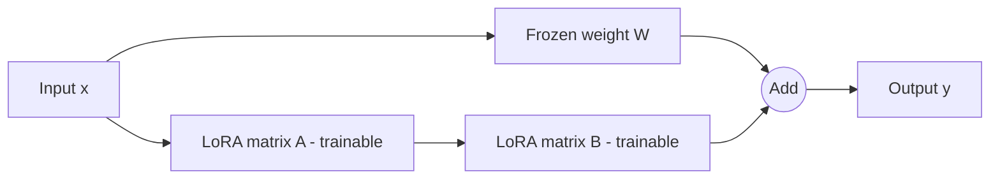
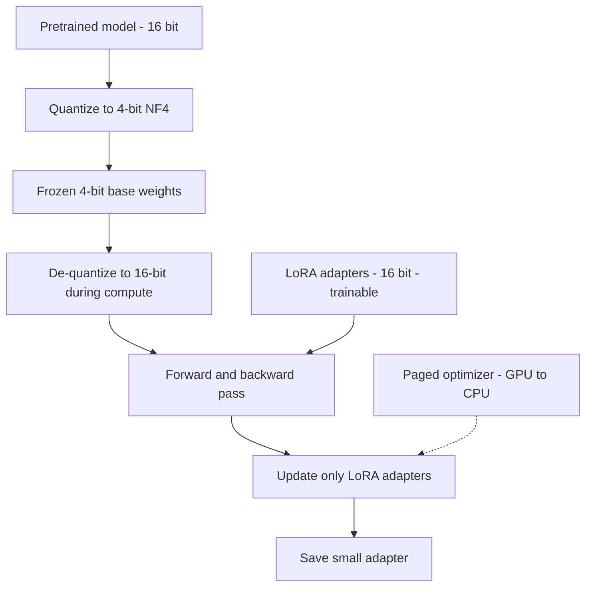
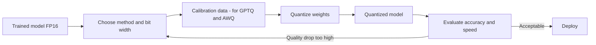

# Prepared By Aamna Ansari 
## Section 8.4 to 8.6 (LoRA, QLoRA, Model Quantization)

## 8.4 LoRA (Low-Rank Adaptation)

### 1. Definition

LoRA is a method to fine-tune a large model without changing its original weights. We freeze the pretrained weights and add two small trainable matrices next to them. Only these small matrices are trained. LoRA was introduced by Hu et al. (2021).

### 2. Why It Matters

Full fine-tuning updates every parameter in the model. For a 7B model, this needs a lot of GPU memory, because we must store gradients and optimizer states for all 7 billion parameters. LoRA trains only a tiny fraction of parameters (often less than 1%), so it needs much less memory. The saved adapter file is also small (megabytes, not gigabytes).

### 3. How It Works

A weight matrix in a transformer layer has size d × k. In full fine-tuning, we learn an update ΔW of the same size. LoRA's idea is that this update has a low "rank", so it can be written as the product of two small matrices:

```
W' = W + ΔW = W + (alpha / r) * B * A

W : original frozen weight   (d x k)
B : trainable matrix         (d x r)
A : trainable matrix         (r x k)
r : rank (small, e.g. 4, 8, 16)
```

- A is initialized with small random values and B is initialized with zeros. So at the start, ΔW = 0 and the model behaves exactly like the base model.
- Only A and B receive gradients.

**Example of parameter saving (approximate):**

- One 4096 × 4096 matrix has about 16.8 million parameters.
- With r = 8, LoRA adds 4096×8 + 8×4096 = 65,536 parameters.
- That is about 0.4% of the original matrix.

**Important settings:**

| Setting | Meaning | Common values |
|---|---|---|
| r (rank) | Size of the small matrices. Higher = more capacity, more memory | 8, 16, 32 |
| lora_alpha | Scaling factor. The update is scaled by alpha / r | 16, 32 |
| target_modules | Which layers get LoRA | q_proj, v_proj (or all linear layers) |
| lora_dropout | Dropout on LoRA layers to reduce overfitting | 0.05 to 0.1 |

### 4. Architecture Diagram



### 5. Advantages

- Uses far less GPU memory than full fine-tuning.
- Trains faster, because fewer parameters are updated.
- The adapter is small, so it is easy to store and share.
- One base model can have many adapters (one per task) and you can switch between them.
- No extra delay at inference if the adapter is merged into the base weights.
- The base model is not changed, so there is less risk of destroying its original knowledge.

### 6. Limitations

- It may not match full fine-tuning quality on very hard tasks or when a lot of new knowledge must be learned.
- Results depend on good choices of r, alpha and target modules.
- The base model still has to be loaded in memory, so a large model still needs a large GPU (this is the problem QLoRA solves).
- It is better at changing behavior and style than at adding lots of new facts.

### 7. Use Cases

- Teaching a model a specific tone, format or task (for example, customer support replies).
- Domain adaptation (medical, legal, finance) when you have a moderate dataset.
- Training many task-specific versions of the same base model.
- Fine-tuning on a single consumer or free-tier GPU.

### 8. Practical Example

```python
from transformers import AutoModelForCausalLM
from peft import LoraConfig, get_peft_model

model = AutoModelForCausalLM.from_pretrained("TinyLlama/TinyLlama-1.1B-Chat-v1.0")

config = LoraConfig(
    r=8,
    lora_alpha=16,
    target_modules=["q_proj", "v_proj"],
    lora_dropout=0.05,
    task_type="CAUSAL_LM",
)

model = get_peft_model(model, config)
model.print_trainable_parameters()   # shows trainable params and percentage
```

This code loads a base model, attaches LoRA adapters to the attention layers, and prints how many parameters are actually trainable.

### 9. Implementation Considerations

- Start with r = 8 or 16. Increase only if the model underfits.
- A common rule is to keep alpha = r or alpha = 2 × r.
- Applying LoRA to all linear layers usually gives better quality than only q_proj and v_proj, at a slightly higher memory cost.
- Use a learning rate higher than full fine-tuning (for example 1e-4 to 2e-4).
- Common mistake: forgetting to match target module names to the model architecture. Layer names differ between models, so check them first.
- After training, you can save only the adapter, or merge it with `merge_and_unload()` for deployment.

### 10. Key Takeaways

- LoRA freezes the base model and trains two small matrices, B and A, so that W' = W + (alpha / r)·BA.
- It cuts trainable parameters to often under 1%, which saves memory and time.
- It is the standard parameter-efficient fine-tuning method and the base of QLoRA.

---

## 8.5 QLoRA (Quantized LoRA)

### 1. Definition

QLoRA is LoRA applied on top of a base model that has been compressed to 4-bit precision. The big base model is stored in 4-bit and frozen. Small LoRA adapters are trained in higher precision (16-bit). It was introduced by Dettmers et al. (2023).

### 2. Why It Matters

LoRA reduces the training memory, but the base model must still be loaded in 16-bit. A 7B model in 16-bit needs about 14 GB just for weights. QLoRA shrinks the weights to about a quarter of that, so large models can be fine-tuned on a single GPU. The QLoRA paper reports fine-tuning a 65B model on one 48 GB GPU.

### 3. How It Works

QLoRA uses three main ideas:

**a) 4-bit NormalFloat (NF4)**
NF4 is a 4-bit data type designed for neural network weights. Pretrained weights usually follow a bell-shaped (normal) distribution. NF4 places its 16 possible values to fit this distribution well, so it loses less information than normal 4-bit integers.

**b) Double Quantization**
Quantization needs extra numbers called "quantization constants" (one for every small block of weights). QLoRA quantizes these constants too. This saves a small amount of extra memory per parameter (the paper reports roughly 0.37 bits per parameter).

**c) Paged Optimizers**
When GPU memory suddenly runs out (for example with a long sequence), optimizer states can be moved to CPU RAM automatically and brought back when needed. This helps avoid out-of-memory crashes.

**Training flow:**

1. Load the base model with weights in 4-bit (NF4).
2. During the forward pass, the weights are de-quantized to 16-bit for each computation.
3. Gradients flow through the frozen 4-bit weights to the LoRA adapters.
4. Only the LoRA adapters (16-bit) are updated.

**Approximate memory for a 7B model weights:**

- 16-bit: 7B × 2 bytes ≈ 14 GB
- 4-bit: 7B × 0.5 bytes ≈ 3.5 GB (plus a little extra for constants, adapters, activations and optimizer states)

### 4. Architecture Diagram



### 5. Advantages

- Very low memory use, so big models fit on small GPUs.
- Quality is close to 16-bit LoRA fine-tuning in the results reported by the authors.
- Free Colab T4 (16 GB) can fine-tune models up to roughly 7B size with careful settings.
- Same small adapter files as LoRA.

### 6. Limitations

- Training is slower than normal LoRA because of the extra de-quantization step.
- 4-bit quantization still loses some precision, so there can be a small quality drop.
- Depends on the bitsandbytes library, which mainly supports NVIDIA GPUs.
- If you merge the adapter into a quantized model, you may lose some accuracy. A safer way is to merge into the 16-bit base model.

### 7. Use Cases

- Fine-tuning 7B to 13B models on a free or low-cost GPU.
- Student projects, research prototypes and quick experiments.
- Companies that want custom models without buying expensive hardware.

### 8. Practical Example

```python
import torch
from transformers import AutoModelForCausalLM, BitsAndBytesConfig
from peft import LoraConfig, get_peft_model, prepare_model_for_kbit_training

bnb_config = BitsAndBytesConfig(
    load_in_4bit=True,
    bnb_4bit_quant_type="nf4",
    bnb_4bit_use_double_quant=True,
    bnb_4bit_compute_dtype=torch.float16,   # use float16 on T4
)

model = AutoModelForCausalLM.from_pretrained(
    "TinyLlama/TinyLlama-1.1B-Chat-v1.0",
    quantization_config=bnb_config,
    device_map="auto",
)

model = prepare_model_for_kbit_training(model)

lora_config = LoraConfig(
    r=16, lora_alpha=32, lora_dropout=0.05,
    target_modules=["q_proj", "k_proj", "v_proj", "o_proj"],
    task_type="CAUSAL_LM",
)
model = get_peft_model(model, lora_config)
model.print_trainable_parameters()
```

The model is loaded in 4-bit NF4 with double quantization, prepared for training, and then LoRA adapters are attached.

### 9. Implementation Considerations

- On a T4 GPU, use `float16` as the compute type. `bfloat16` is not well supported on T4.
- Turn on gradient checkpointing and use a small batch size with gradient accumulation.
- Use a paged optimizer such as `paged_adamw_8bit` in your training arguments.
- Keep the max sequence length reasonable (for example 512 or 1024) to save memory.
- Common mistake: skipping `prepare_model_for_kbit_training`, which can cause unstable training.
- Always test the final model on a few prompts. Quantization effects are not always visible in the loss alone.

### 10. Key Takeaways

- QLoRA = 4-bit (NF4) frozen base model + trainable 16-bit LoRA adapters.
- Double quantization and paged optimizers save even more memory.
- It makes fine-tuning of large models possible on a single, small GPU, with a small speed cost.

---

## 8.6 Model Quantization

### 1. Definition

Quantization means storing a model's numbers (weights, and sometimes activations) using fewer bits. For example, we can change 16-bit floating point numbers into 8-bit or 4-bit integers. The model becomes smaller and often faster, with a small loss in accuracy.

### 2. Why It Matters

LLMs are very large. Memory is usually the biggest problem, both for training and for running the model (inference). Quantization reduces memory use, which lowers the hardware cost and can speed up inference, especially on devices with limited memory.

### 3. How It Works

**Memory per parameter:**

| Format | Bytes per parameter | Approx. size for 7B model |
|---|---|---|
| FP32 (32-bit float) | 4 | 28 GB |
| FP16 / BF16 (16-bit float) | 2 | 14 GB |
| INT8 (8-bit integer) | 1 | 7 GB |
| INT4 (4-bit integer) | 0.5 | 3.5 GB |

*These are approximate, for weights only. Real usage is higher because of activations, the KV cache and other overhead.*

**Basic idea (simple linear quantization):**

```
scale = (max_value - min_value) / (q_max - q_min)
q = round(x / scale) + zero_point          # quantize
x_approx = (q - zero_point) * scale        # de-quantize
```

Float values are mapped to a small set of integers using a scale factor. When we need the real values again, we de-quantize. The difference between x and x_approx is the quantization error.

**Two main approaches:**

- **Post-Training Quantization (PTQ):** Quantize an already trained model. Fast and simple, no retraining needed. Most LLM quantization methods are PTQ.
- **Quantization-Aware Training (QAT):** Simulate quantization during training so the model learns to handle the error. Often better quality, but it needs more compute.

**Popular methods and formats:**

| Method | Short description | Typical use |
|---|---|---|
| bitsandbytes (LLM.int8, NF4) | Easy loading of 8-bit and 4-bit models in Hugging Face | Fine-tuning (QLoRA) and quick inference |
| GPTQ | PTQ that uses a small calibration dataset to reduce error layer by layer | GPU inference |
| AWQ | Activation-aware quantization that protects the most important weights | GPU inference with good quality |
| GGUF | File format used by llama.cpp, with many quantization levels (Q4, Q5, Q8) | Running on CPU, laptops and edge devices |

### 4. Process Diagram



### 5. Advantages

- Much smaller model size and lower memory use.
- Can allow big models to run on small GPUs or even CPUs.
- Often faster inference, because less data has to be moved from memory.
- Lower serving cost.

### 6. Limitations

- Some accuracy loss, which grows when the bit width gets very low (for example 3-bit or 2-bit).
- Quality loss is not the same for all tasks. Reasoning, math and code are often more sensitive.
- Speed gain depends on the hardware and software support. Some setups do not become faster.
- Different methods and formats are not always compatible with each other.
- Outliers (very large values) in weights or activations make quantization harder.

### 7. Use Cases

- Running a 7B or 13B model on a laptop or a single consumer GPU.
- Cutting the cost of serving a model in production.
- Memory-efficient fine-tuning (QLoRA).
- Edge and offline applications.

### 8. Practical Example

```python
import torch
from transformers import AutoModelForCausalLM, BitsAndBytesConfig

# Load in 8-bit
model_8bit = AutoModelForCausalLM.from_pretrained(
    "TinyLlama/TinyLlama-1.1B-Chat-v1.0",
    quantization_config=BitsAndBytesConfig(load_in_8bit=True),
    device_map="auto",
)

# Load in 4-bit (NF4)
model_4bit = AutoModelForCausalLM.from_pretrained(
    "TinyLlama/TinyLlama-1.1B-Chat-v1.0",
    quantization_config=BitsAndBytesConfig(
        load_in_4bit=True,
        bnb_4bit_quant_type="nf4",
        bnb_4bit_compute_dtype=torch.float16,
    ),
    device_map="auto",
)

print(model_4bit.get_memory_footprint() / 1e9, "GB")
```

This loads the same model in 8-bit and 4-bit, and prints the memory used by the 4-bit version. You can use this to build a small comparison table in your results.

### 9. Implementation Considerations

- Start with 8-bit if quality is the priority, and 4-bit if memory is the priority.
- Always compare the quantized model with the original on your own test prompts.
- Use a calibration dataset that looks like your real data (for GPTQ and AWQ).
- Choose the format by hardware: GPTQ or AWQ for GPUs, GGUF for CPU or local use.
- Common mistake: judging a quantized model only by its size. Always check output quality and speed too.
- For fine-tuning, quantize the base model but keep the trainable adapter weights in 16-bit.

### 10. Key Takeaways

- Quantization stores numbers in fewer bits (FP16 to INT8 or INT4) to save memory.
- There is always a trade-off between size, speed and accuracy.
- bitsandbytes is used for QLoRA, GPTQ and AWQ for GPU serving, and GGUF for CPU and local use.

---

## References for these sections

1. Hu, E. et al. (2021). *LoRA: Low-Rank Adaptation of Large Language Models.* arXiv:2106.09685.
2. Dettmers, T. et al. (2023). *QLoRA: Efficient Finetuning of Quantized LLMs.* arXiv:2305.14314.
3. Dettmers, T. et al. (2022). *LLM.int8(): 8-bit Matrix Multiplication for Transformers at Scale.* arXiv:2208.07339.
4. Frantar, E. et al. (2022). *GPTQ: Accurate Post-Training Quantization for Generative Pre-trained Transformers.* arXiv:2210.17323.
5. Lin, J. et al. (2023). *AWQ: Activation-aware Weight Quantization for LLM Compression and Acceleration.* arXiv:2306.00978.
6. Hugging Face documentation: PEFT, Transformers quantization guides, bitsandbytes.
7. llama.cpp project (GGUF format): https://github.com/ggerganov/llama.cpp


